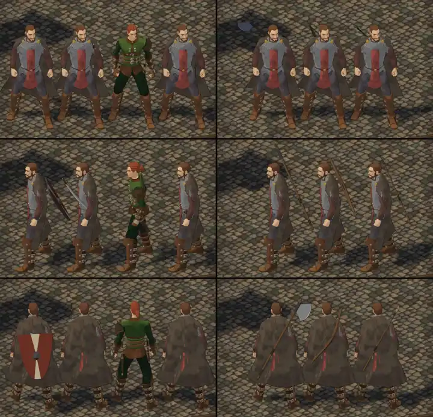

# 410 · Waffen wegstecken, nachgebessert (aus 376.1) · Tom · 29.10., 11:50

Nachgebessert nach deinem Urteil von 11:40 und dem Befund des Prüfers:
- **Schild:** sitzt jetzt hoch, die Oberkante 3 cm unter der Schulter. Vorher lag sie 13 cm darunter.
- **Kämpfer:** Griff und Parierstange des Schwerts ragen über die Schildkante, über der rechten Schulter.
- **Kleriker:** Der Stab liegt steiler unter dem Schild und geht nicht mehr durch die Schulter.
- **Zauberer:** Der Stab folgt der Neigung des Rückens.

- **Links:** Handbeil unter dem Schild, nur das Griffende schaut heraus; Krummsäbel in der Scheide (vorher blank vor der Brust); Kurzschwert und Dolch in zwei Scheiden; Handbeil in der Gürtelschlaufe.
- **Rechts:** Großaxt, Kurzbogen und Speer auf dem Rücken, dicht am Umhang.

Noch offen: Beim Zauberer stechen die Knie durch die Robe. Das ist ein Fehler der Tracht, nicht des Wegsteckens, und kommt als eigener Schritt. Die Frisuren sind abgenommen (11:43).

Großbild: Telegram 29.10., 11:50.

**Was du sagen sollst:** Passt das Wegstecken so?

Erledigt: Datei löschen.
