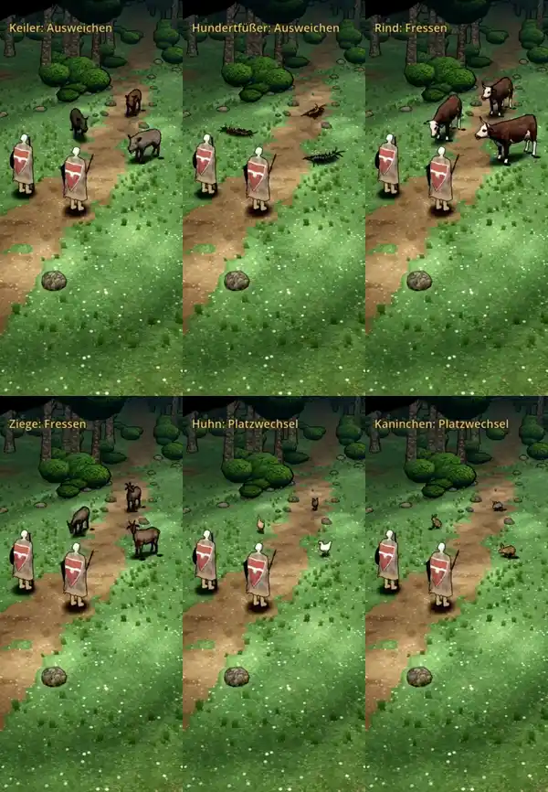

# 387 · Sechs gekaufte Tiere mit Nacharbeit und Wegen über den Kampfort · Team Jerry · 28.10., 00:38

**Frage:** Passt die Richtung bei jedem der sechs Tiere? Das ist dein Auftrag von 22:31 („Alle grundsätzlich nehmen außer die ausgeschlossenen“) und 22:34 („Alles in eins packen“). Sag je Tier „ja“ oder was anders sein soll. Die Fehler unten behebe ich ohnehin.

**Bitte ansehen:** [Film](https://cdn.jsdelivr.net/gh/tramour-cmyk/androidapp_rpg_bornim@bilder/pruefung/387-kauftiere-r2.mp4), 148 s. Je Art stehen drei Tiere da, das vorderste bewegt sich. Start im Film: Keiler 0 s, Hundertfüßer 35 s, Rind 86 s, Ziege 100 s, Huhn 113 s, Kaninchen 132 s.
- Keiler und Hundertfüßer: Anlauf, Biss, Ausweichen, Sprung, Treffer, Ortswechsel, Tod.
- Dorftiere: Anlauf, Fressen, Ortswechsel, Tod.

**Was gebaut ist:**
- Keiler: Er schwebt nicht mehr und fällt im Tod um. Vorher war die Todesbewegung des gekauften Modells verkehrt herum, er stand darin wieder auf.
- Hundertfüßer: Am Modell gemessen ist er 1,5 m lang statt 1,24 m. Die blauschwarze Färbung ist heller als vorher. Sein Gehen läuft schneller ab, damit man es vom Stehen unterscheiden kann.
- Huhn: drei Gefieder, braun, hell und schwarz. Kaninchen: graubraun, braun und grau.
- Alle Tiere gehen und laufen über den Kampfort, im Tempo ihrer Beine. Ihr Bodenschatten ist so groß wie sie selbst. Ausnahmen siehe unten.

**Fehlerprüfung (fremder Prüfer, eine Runde, 00:30), Zeiten im Film:**
- **Offen (hoch):**
  - Huhn: Bei 116–118 s wird es zu einem hellen, länglichen Fleck ohne Kopf, Beine und Schatten und rutscht über den Boden.
  - Kaninchen: Beim Ortswechsel gleitet es sitzend, ohne zu hoppeln (138–141 s). Im Tod hängt es kopfunter in der Luft (146 s).
- **Offen (mittel):**
  - Keiler: Er dreht sich in einem Bild um etwa 90° (6, 9 und 11 s). Neben einem Lauf wandert ein schwarzer Fleck mit, sein Schatten liegt dort falsch.
  - Huhn: Das braune Huhn wirkt blass beige, der Kamm ist nicht zu sehen. Von vorn sieht das schwarze Huhn aus wie eine Katze.
  - Rind und Ziege: Im Tod überschlägt sich das Rind kopfüber, die Ziege liegt auf dem Rücken. So kommen die Bewegungen mit dem gekauften Modell.
  - Rind, Ziege, Hundertfüßer laufen durch Büsche. Die Probe stellt sie an Plätze, an denen Büsche stehen. Beim Biss stecken sie in der Heldin.
  - Hundertfüßer: Im Film wirkt er nur 0,7–1 m lang, obwohl er 1,5 m misst. Von vorn sieht er aus wie ein Käfer.
- **Offen (gering):**
  - Nach dem Fallen blenden alle Tiere aus. Das tut im Kampf jeder Gegner.
  - Der Hundertfüßer braucht für den Biss samt Heimweg 15 s, weil er langsam geht.
  - Von den drei Hundertfüßern ist nur einer blauschwarz, die anderen sind rostrot und ocker. Das sind die drei Farben aus der Figurenliste.

**Danach:** Nach deinem Urteil behebe ich die offenen Punkte und lege dir das Ergebnis neu vor.
