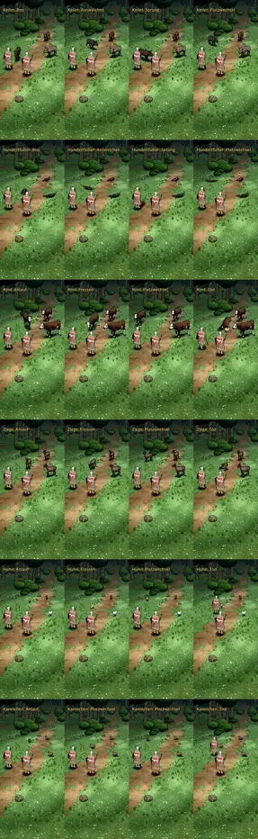

# 387 · Sechs gekaufte Tiere, Runde 3: Fehler teils behoben · Team Jerry · 28.10., 04:19

**Morgenblatt.** Ersetzt das Blatt von Runde 2 (00:38). Die Frage von dort gilt weiter.

**Frage:** Passt die Richtung bei jedem der sechs Tiere? Das ist dein Auftrag von 22:31 („Alle grundsätzlich nehmen außer die ausgeschlossenen“) und 22:34 („Alles in eins packen“). Sag je Tier „ja“ oder was anders sein soll. Die Fehler unten behebe ich ohnehin.

**Bitte ansehen:** [Film](https://cdn.jsdelivr.net/gh/tramour-cmyk/androidapp_rpg_bornim@bilder/pruefung/387-kauftiere-r3.mp4), 155 s. Start im Film: Keiler 0 s, Hundertfüßer 36 s, Rind 89 s, Ziege 103 s, Huhn 116 s, Kaninchen 137 s.

**Behoben seit Runde 2** (laut fremdem Prüfer):
- Der Keiler dreht sich nicht mehr in einem Bild um 90°, sondern über etwa fünf Bilder. Geändert habe ich dafür das Vorzeichen der Drehungen im Modell. Godot blendete vorher über den langen Weg.
- Die Ziege liegt im Tod nicht mehr auf dem Rücken.
- Das Rind läuft vor dem Busch vorbei statt hindurch.

**Was der fremde Prüfer gefunden hat** (offen, Zeiten im Film des Tiers):
- **Hoch:**
  - Huhn: Beim Fressen und beim Platzwechsel ist es ein heller, spitzer Fleck ohne Kopf und Beine. Am Rechner sieht dieselbe Bewegung richtig aus. Die Ursache im Spiel suche ich noch.
  - Kaninchen: Beim Platzwechsel sitzt es aufrecht und rutscht, obwohl laut Messung die Rennbewegung läuft. Im Tod kippt es kopfüber und schwebt.
  - Rind: Im Tod kippt es nach vorn über den Kopf.
  - Hundertfüßer: Er wirkt meist wie ein kurzer Klumpen von etwa 1 m, von vorn wie ein Käfer, die Länge springt. Beim Biss kreist er 4 s zwischen den Heldinnen, beim Platzwechsel wackelt er 3 s auf der Stelle.
- **Mittel:**
  - Keiler: Neben einem Lauf wandert ein dunkler Fleck mit. Beim Biss franst sein Umriss für 2–3 Bilder aus.
  - Ziege: Im Tod ist der Kopf unter den Körper gedreht. Beim Platzwechsel dreht sie auf der Stelle, die Beine rutschen, einmal schwebt sie.
  - Hundertfüßer: Beim Biss liegt er über Kopf und Schulter der Heldin.
  - Braunes Huhn: blass beige, der Kamm ist nicht zu sehen.
- **Gering:** Beide Heldinnen zucken in allen Filmen für 2–3 Bilder in eine Schrittstellung. Das kommt aus der Probe und ist Tom schon gemeldet.

**Danach:** Ich suche die Ursachen am Rechner. Ein Probelauf ist für 387 noch frei.
