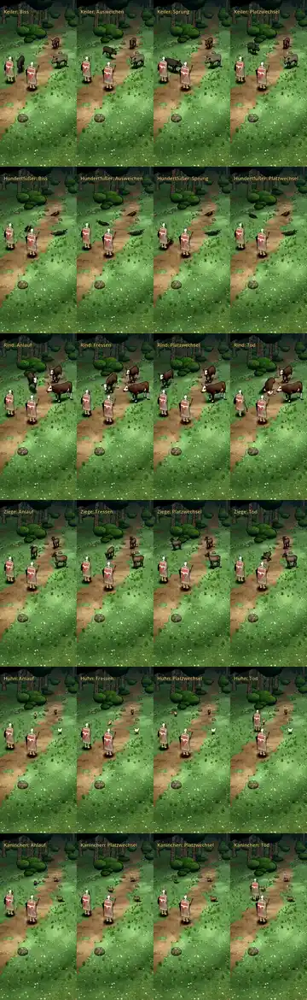

# 387 · Sechs gekaufte Tiere, Runde 4: Ursachen gefunden, vieles liegt in den gekauften Bewegungen · Team Jerry · 28.10., 05:45

**Morgenblatt** (zum Ansehen am Morgen). Ersetzt das Blatt von Runde 3 (04:19). Das ist der Stand nach den zwei erlaubten Probeläufen (389).

**Frage (wie in Runde 3):** Passt die Richtung bei jedem der sechs Tiere? Sag je Tier „ja“ oder was anders sein soll.

**Bitte ansehen:** Film (Link in der Telegram-Meldung 387), 156 s. Start im Film: Keiler 0 s, Hundertfüßer 36 s, Rind 90 s, Ziege 104 s, Huhn 117 s, Kaninchen 138 s. „Platzwechsel“ heißt: das Tier läuft auf einen anderen Platz und zurück.

**Was ich gemessen habe:** Ich messe jetzt in jedem Bild der Probe, wie groß das Tier im Spiel wirklich ist. Bei allen sechs Tieren stimmt das mit dem Bauprogramm überein. Die Fehler entstehen also nicht beim Übertragen ins Spiel. Sie stecken in den gekauften Bewegungen, im Blickwinkel der Kamera oder in unserem Kampfablauf.

**Behoben** (laut fremdem Prüfer):
- Kaninchen: Es liegt im Tod auf der Seite, nicht mehr kopfüber und nicht schwebend. In der gekauften Todesbewegung kippt der Rücken bis 49° nach vorn, der Kopf steckt 26 cm im Boden. Das gleiche ich beim Bau jetzt aus.
- Ziege: Im Tod liegt der Kopf vorn am Boden, nicht unter dem Körper.
- Keiler: Der Umriss franst beim Biss nicht mehr aus.
- Hundertfüßer: Beim Platzwechsel wackelt er weniger. Seine Beine liefen bis zu 14-mal so schnell wie gekauft, jetzt höchstens 3,5-mal. Die Bilder sprangen zwischen den Beinstellungen. Das Tempo über den Boden ist gleich geblieben.

**Behoben, vom Prüfer nicht prüfbar:** Beim Umdrehen hielt das Spiel die Pfoten am Boden fest. Lief das Tier danach los, blieben die Pfoten bis zu 1,1 s stehen, gemessen beim Keiler. Behoben während des Probelaufs: im Film bei den fünf übrigen Tieren schon drin, beim Keiler noch nicht.

**Noch offen** (laut fremdem Prüfer, dazu meine Messung):
- **Rind im Tod:** Der Prüfer sieht es nach vorn überschlagen, Bauch zur Kamera, Kopf unten im Bild, Hinterteil oben. Gemessen liegt es am Ende auf der Seite: 0,67 m hoch, 2,79 m lang. In der gekauften Bewegung neigt sich der Rücken beim Fallen bis etwa 16° und liegt am Ende waagerecht. Von vorn gesehen kann das wie ein Überschlag wirken. Bitte selbst ansehen.
- **Huhn:** Beim Fressen sieht man nur einen hellen Tropfen ohne Kopf und Beine. Das Spiel zeigt dieselbe Haltung wie das Bauprogramm: 0,50 m hoch statt 0,59 m im Stehen. Das Huhn ist klein und von vorn kaum zu lesen. Es ist blass beige, einen roten Kamm sieht man nicht.
- **Kaninchen läuft:** Von hinten wirkt es weiter aufrecht und gleitend, Hoppeln sieht man nur in einzelnen Bildern. Die gekaufte Rennbewegung hob den Kopf und drückte das Hinterteil 9 cm in den Boden. Jetzt hoppelt es mit der gekauften Gehbewegung, 1,3-mal so schnell. Auch dabei hebt sich der Vorderkörper, der Bauch bis 5 cm über den Boden.
- **Hundertfüßer:**
  - Beim Biss kreist er rund 14 s zwischen den Heldinnen. Er läuft 0,7 m/s, für die Wege um die Heldinnen herum ist das langsam.
  - Der Prüfer schätzt ihn von vorn auf 0,7 m, von der Seite auf 1,3 m. Gemessen ist er gestreckt 1,45–1,65 m lang. Beim Biss bäumt er sich auf: dann 0,67 m lang und 0,98 m hoch. Im Tod rollt er sich auf 0,55 m zusammen.
  - Beim Aufbäumen liegt er im Bild über Kopf und Schulter der Heldin.
- **Schweben beim Laufen** (Rind, Ziege, Keiler, Huhn): Gemessen sind die Tiere beim Rennen ganz in der Luft, das Rind bis 20 cm, Keiler 13 cm, Huhn 15 cm. Der Schatten bleibt am Boden. Das Kaninchen hebt sich bis 5 cm.
- **Schwarzer Fleck:** Er wandert neben Keiler und Rind mit. Vermutlich der Schatten einer Pfote, noch nicht gemessen.
- Die Heldinnen stehen manchmal ein Bild lang in Schrittstellung. Das kommt aus der Probe und ist Tom gemeldet.

**Danach:** Je Tier baue ich nach deinem Urteil weiter. Wenn du die Richtung bestätigst, schlage ich vor:
- Hundertfüßer: schneller über den Boden, die Beine bleiben bei höchstens 3,5-fach;
- Huhn: kräftiger braun, mit sichtbarem Kamm;
- Kaninchen: eine eigene Hoppelbewegung.
