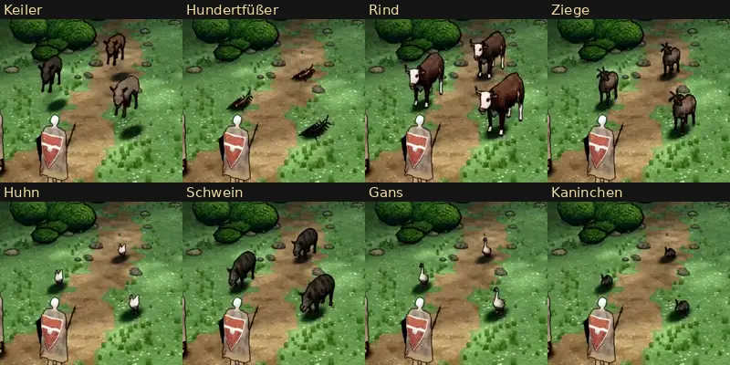

# 387 · Gekaufte Tiere schnell geprüft: Bewegungen und unsere Bemalung · Team Jerry · 27.10., 22:25

**Frage:** Welche gekauften Tiere nehmen wir? Auf deinen Auftrag 21:27 (über Sokrates): erst schnell prüfen, ob die Bewegungen taugen und unsere Bemalung draufpasst, bevor wir wieder selbst bauen. Mein Vorschlag steht in der letzten Spalte. Sag je Tier „ja“, „nein“ oder was anders sein soll. Den Wolf hast du um 21:51 schon genommen.

**Bitte ansehen (Morgenblatt):** [Film](https://cdn.jsdelivr.net/gh/tramour-cmyk/androidapp_rpg_bornim@bilder/pruefung/387-kauftiere.mp4), alle acht Tiere nacheinander, je Tier jede Bewegung des Kaufs auf der Stelle, Titel oben. Start im Film: Keiler 0 s, Hundertfüßer 12 s, Rind 22 s, Ziege 37 s, Huhn 53 s, Schwein 65 s, Gans 78 s, Kaninchen 93 s.

So ist die Probe gebaut: Körper und Bewegungen aus dem Kauf, je drei Tiere auf den Plätzen der Wölfe, in echter Größe. Bemalung: Keiler und Hundertfüßer in unseren Farben; bei den übrigen die Farbe des Kaufs, etwas blasser und dunkler (ein weißes Huhn bleibt darum fast weiß, ein dunkles Kaninchen fast schwarz). Dazu unsere Fellstriche und Tusche-Linien. Augen sind nicht eigens bemalt. Die Tiere bewegen sich noch nicht über den Kampfort (beim Wolf: hin zum Ziel und zurück), und es gibt keine Feinarbeit.

Was gebraucht wird: Kampftiere (Keiler, Hundertfüßer) brauchen Stehen, Gehen, Rennen, Angriff, Treffer, Ausweichen, Tod. Dorftiere brauchen Stehen, Gehen, Fressen; Rennen und Tod sind gut zu haben.

| Tier | Bewegungen im Kauf | Was der fremde Prüfer im Film sah | Fehlt | Vorschlag |
|---|---|---|---|---|
| Keiler (Kampf) | Stehen, Gehen, Rennen, Hauer, Fressen, Tod | Die Bewegungen laufen sauber. Er schwebt etwa 0,3 m über dem Boden. Im Tod kippt er und steht wieder auf (Tod 0,6 s; Ursache offen). | Treffer, Ausweichen | ja; Schweben und Tod sind zu beheben, ob es gelingt, ist noch offen |
| Hundertfüßer (Kampf) | Stehen, Gehen, Drohen, Biss, Treffer, Tod | Biss, Treffer, Drohen und Tod (auf den Rücken, eingerollt) laufen. Das Gehen ist im Film kaum vom Stehen zu unterscheiden. Die blauschwarze Färbung ist fast schwarz, die Zeichnung ist nicht zu sehen. Er ist 1,24 m lang, die Liste der Figuren verlangt 1,4–1,6 m. | Rennen, Ausweichen | ja; größer, die dunkle Färbung heller |
| Rind (Dorf) | Stehen, Gehen, Rennen, Stoß, Fressen, Tod | alles in Ordnung | – | ja |
| Ziege (Dorf) | Stehen (zwei Arten), Gehen, Rennen, Stoß, Fressen, Tod | alles in Ordnung | – | ja |
| Huhn (Dorf) | Stehen, Gehen, Rennen, Fressen, Tod | Gehen und Rennen sind kaum zu sehen, man sieht nur leichtes Wippen. Es ist reinweiß; Kamm, Schnabel und Auge sind nicht zu sehen. | – | ja, mit eigener Bemalung |
| Schwein (Dorf) | Stehen, Gehen, Fressen, Tod | Die Beine sind falsch oder fehlen. Der Tod ist nicht zu sehen (er steckt nur in einem kurzen Stück der Datei). Der Kopf ist immer gesenkt, es ist sehr dunkel. | Rennen | nein, so nicht nutzbar (siehe unten) |
| Gans (Dorf) | Stehen, Gehen, Rennen, Fressen, Tod | Sie bewegt sich gar nicht, auch nicht im Tod. | – | nein, so nicht nutzbar (siehe unten) |
| Kaninchen (Dorf) | Stehen, Gehen, Rennen, Fressen, Tod | Gehen und Rennen schwach, aber sichtbar. Es ist fast schwarz, ohne Zeichnung. Ob der Kopf vorn ist, war im Film nicht sicher zu erkennen. | – | ja, mit eigener Bemalung |

**Fehlerprüfung des Films (fremder Prüfer, eine Runde, bis 22:15), Befunde bei allen Tieren:**
- Der runde Bodenschatten hat noch die Größe des Wolfs: Bei Huhn, Gans und Kaninchen ist er doppelt so breit wie das Tier.
- Alle 3 s machen die Heldinnen für 2 Bilder einen Schritt und zurück. Das betrifft die Heldinnen, nicht die Tiere; ich gebe es an Team Tom.
- Tusche-Linien sind bei allen Tieren da. Bei den sehr dunklen gehen sie im Körper unter.

**Was ich selbst nachgemessen habe:**
- Keiler: In Stehen, Gehen, Rennen, Hauer und Fressen ist der Körper um 0,44 m nach oben und 0,3 m zur Seite versetzt (im Film sah der Prüfer davon etwa 0,3 m). Nur im Tod sitzt der Körper richtig.
- Schwein und Gans stammen aus einer zweiten, älteren Reihe des Janpec-Pakets. Ihre Beine werden dort von Zielpunkten außerhalb des Skeletts geführt, die beim Laden verloren gehen. Jede Bewegung steckt dort in einer langen Datei von 18–27 s, das richtige Stück muss erst herausgesucht werden. Brauchbar wären sie nur mit mehr Arbeit, und ob das gelingt, ist offen.

Vor dem Eigenbau geprüft: genommen sind Janpec Animal Pack Deluxe (Keiler, Rind, Ziege, Huhn, Schwein, Gans, Kaninchen) und MadeCG Hundertfüßer. Im Janpec-Paket gibt es außerdem Bär, Hirsch, Steinbock, Schlange, Skorpion, Krokodil, Feuersalamander, Frosch, Krabbe, Krake, Ratte (klein), Fische, Schmetterling, Schnecke und einen Steinadler (nur das Bild der Bemalung gesehen); sie sind noch nicht geprüft.

**Danach:** Für jedes Tier mit „ja“ baue ich die Bemalung und die Wege über den Kampfort wie beim Wolf und lege es einzeln vor.
