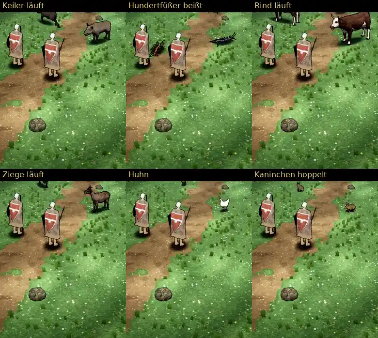

# 387 · Gekaufte Tiere Runde 5: Hundertfüßer schneller, Huhn größer, Kaninchen hoppelt · Team Jerry · 28.10., 10:05

**Frage:** Passen Hundertfüßer, Huhn und Kaninchen so? Sag je Tier „ja“ oder was anders sein soll.

**Bitte ansehen:** [Film](https://cdn.jsdelivr.net/gh/tramour-cmyk/androidapp_rpg_bornim@bilder/pruefung/387-kauftiere-r5.mp4), 128 s: Keiler 0 s, Hundertfüßer 35 s, Rind 68 s, Ziege 82 s, Huhn 95 s, Kaninchen 112 s. „Platzwechsel“ heißt: das Tier läuft auf einen anderen Platz und zurück.

**Geändert nach deinem Wort (08:09):**
- Hundertfüßer: Er läuft jetzt 0,8 m/s im Gehen und 2,0 m/s im Rennen, vorher 0,35 und 0,7. Bis zum Biss braucht er etwa 2 s statt rund 14 s Kreisen. Die Beine laufen sichtbar mit.
- Huhn: 1,2-mal so groß (0,72 m im Spiel), dunkleres Braun; den roten Kamm dunkle ich nicht mehr ab.
- Kaninchen: eigenes Hoppeln aus der gekauften Rennbewegung. Es neigt sich weniger nach hinten, steckt nicht mehr im Boden und ist in jedem Sprung kurz ganz in der Luft. Etwa 3,3 Sprünge je Sekunde, 0,9 m/s.

**Außerdem behoben:**
- Schweben beim Laufen: Vorher war das Huhn bis 18 cm, das Rind bis 20 cm in der Luft. Beim Platzwechsel misst der Prüfer jetzt bei Keiler, Rind und Hundertfüßer höchstens 1–3 Bildpunkte, das Huhn steht auf dem Schatten (Ziege siehe unten).
- Der zweite dunkle Fleck neben den Pfoten: Beim Kaninchen findet der Prüfer ihn nicht mehr. Bei frei laufenden Pfoten liegt laut meiner Messung kein Fleck mehr daneben (Rest siehe unten).
- Der Text oben passt in die Breite.

**Was der fremde Prüfer gefunden hat:**
- Tod: Kein Tier bleibt liegen. Jedes fällt, liegt 0,2–0,4 s, zerfällt und ist nach 1,5–2 s weg. Das Rind zerfällt, bevor es liegt, und fällt mit dem Kopf nach unten.
- Flecken: Bei Rind, Keiler und Ziege liegen weiter dunkle Flecken 12–29 Bildpunkte neben den Hufen. Dazu meine Messung: Alle liegen dort, wo das Spiel die Hufe beim Umdrehen festhält, dieselben wie bei 348.12f. Kommt das Bein beim Umdrehen nicht bis zur Stelle, an der der Huf stehen soll, bleibt der Fleck zurück. Im Code behoben, noch nicht im Film (die zwei erlaubten Probeläufe sind verbraucht).
- Ziege: Beim Anlauf und Platzwechsel wirkt sie bis 8 Bildpunkte über dem Schatten. Die Beine sind dabei angezogen, ein Huf hat Boden. Das Rind hebt beim Anlauf von vorn einen Vorderhuf 4 Bildpunkte über den Schatten.
- Hundertfüßer: Auf dem Weg zum Biss macht er einen Umweg hinter die rechte Heldin. Beim Biss steckt der Kopf unter dem Umhang der linken Heldin. Am Ende des Aufbäumens springt das Bild in zwei Bildern. Der Abschnitt „Sprung“ sieht aus wie der Biss, der gekaufte Hundertfüßer hat keinen Sprung. Laut Messung stecken die Beine beim Biss bis 4 cm im Boden, im Bild ist das nicht zu sehen.
- Huhn: Das Braun wirkt im Licht goldbraun bis orange-ocker. Der Kamm ist von der Seite 6 × 11 Bildpunkte groß, von hinten nur 2 Bildpunkte. Beim Fressen sieht man Kopf und Schnabel nicht. Es ist 28 % so hoch wie die Heldin.
- Kaninchen: Von hinten wirkt es weiter aufrecht sitzend (Kopf oben, Pfoten fast auf einer Höhe).
- Keiler: Am Bein der Heldin überlappt er bis 5 Bildpunkte, die Heldin ist richtig davor gemalt.
- In Ordnung: keine Sprünge beim Drehen, kein Text abgeschnitten.

**Danach:** Je Tier baue ich nach deinem Wort weiter. Den Fleck beim Umdrehen zeige ich im nächsten Film.
