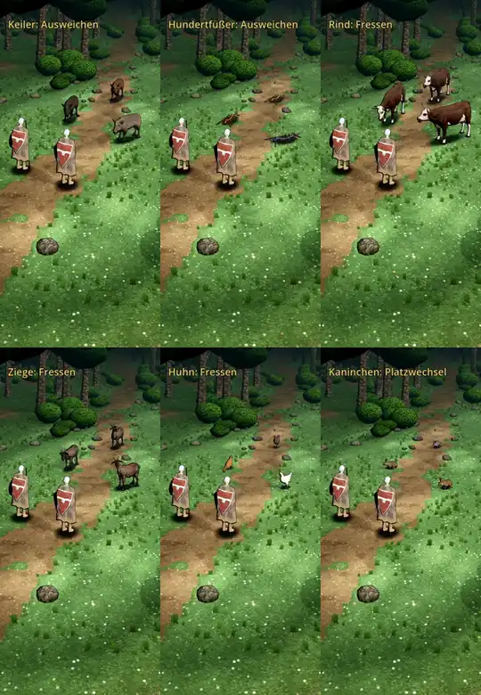

# 387 · Gekaufte Tiere mit unserer Tusche nach Licht · Team Jerry · 28.10., 12:05

**Frage:** Passt die Tusche an den Tieren so? Sag „ja“ oder was anders sein soll.

**Bitte ansehen:** [Film](bilder:pruefung/387-kauftiere-r6.mp4), 128 s: Keiler 0 s, Hundertfüßer 35 s, Rind 68 s, Ziege 82 s, Huhn 95 s, Kaninchen 112 s.

**Geändert nach deinem Wort (10:51, „unser Tuscherahmen nach Lichteinfall“):**
- Alle sechs Tiere haben den Tuscherand wie Held und Goblins im Kampf: dicker auf der Schattenseite, dünn zur Sonne, gleiche Linienstärke, Sonne wie im Kampfort.
- Der Film ist in voller Breite (540 statt 360 Bildpunkte), damit man die Linie sieht.
- An den Tieren selbst ist sonst nichts geändert.

**Danach:** Nach deinem „ja“ baue ich die Tiere ins Spiel ein.
