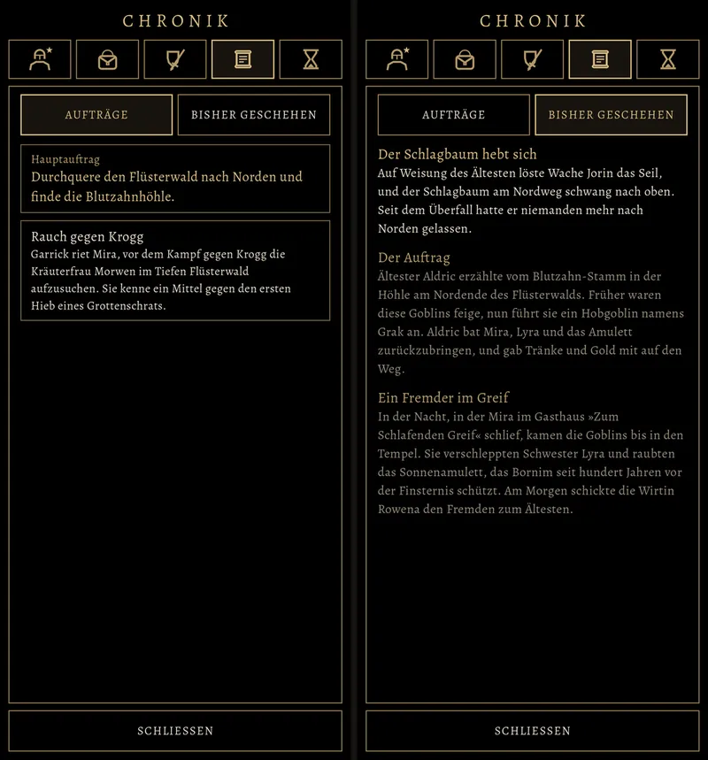

# 399.1 · Menü: Benutzen und Ausrüstung wie alt · Tom · 28.10., 17:15

Probe am Rechner, noch kein Build; fährt im nächsten Build mit. Von links nach rechts: Tasche, Kasten nach Antippen des Heiltranks, neuer Reiter Ausrüstung, Kasten nach Antippen der Haupthand. Der Held in der Mitte fehlt nur in der Probe (sein Modell entsteht erst im Build).

Wie im alten Spiel (`MenuScreen.kt` BagTab, GearTab): Vorräte antippen und benutzen (Heiltrank, Kräutertrank heilt auch Gift, Essen, Ausdauertrank, Leuchtfunke); Ausrüstung in der Tasche anlegen, in die Nebenhand, wegwerfen mit Rückfrage. Reiter Ausrüstung: Plätze links und rechts des Helden; antippen legt ab, wechselt oder wählt aus der Tasche; darunter die Kampfwerte. Noch nicht: Bilder der Dinge, Vergleich mit dem Getragenen.

**17:27, dazu:** die Reiter als gezeichnete Zeichen wie alt (Held mit Stern bei offenen Punkten, Tasche, Ausrüstung, System) und der Reiter System mit Speichern, Sprache, Hauptmenü. Bilder v. l. n. r.: Held, Ausrüstung, System.

Befunde des Prüfers, nicht geändert: das Zeichen Ausrüstung (Schild, Schwert) liest sich eher als Schild mit Strich; es ist genau das alte Zeichen. Der Name „Arkanes Heiligensymbol“ beim Magier stammt aus den alten Daten; ein Heiligensymbol ist eigentlich der Fokus des Klerikers (an Homer). Schaden und Zauberangriff unterscheiden sich zwischen Held und Ausrüstung, weil in der Probe dazwischen das Symbol angelegt wird (Stab dann einhändig).

**17:34, dazu:** Reiter Chronik wie alt (`ChronicleTab`): Aufträge (Hauptauftrag in Gold, Aufträge der Geschichte, Erledigtes zum Aufklappen) und Bisher geschehen (das Neueste oben); Texte wortgleich aus dem alten Spiel. Bilder: Aufträge, Bisher geschehen.

Befunde des Prüfers: der Eintrag über Garrick fehlt, weil die Probe „Rauch gegen Krogg“ setzt, ohne dass der Held Garrick traf (Probedaten, kein Fehler im Spiel). Ältere Titel sind wie alt nur wenig dunkler als der neueste. Noch nicht: Nebenaufträge vom Anschlagbrett (das Brett fehlt noch) und die Knöpfe, mit denen man Ankunft und Morgenandacht noch einmal ansieht.

**17:58, dazu:** Reiter Karte wie alt (`MapTab`): das Dorf als Tuscheblatt, vergrößert auf dem Helden (roter Ring, Keil in Blickrichtung), ein Finger schiebt, zwei zoomen; Schalter Aufträge, Leute, Dienste; Zeichen für den Ältesten mit dem Hauptauftrag, Leute, die der Held angesprochen hat, Schänke, Laden, Tempel; Schilder über Häusern, die er kennt, Antippen öffnet den Grundriss; der Knopf oben geht zur Gebietskarte, dann zur Landkarte. Ohne Bild: die zwei Probeläufe liefen ohne die Karte; du siehst sie im nächsten Build. Noch nicht: Wald und Höhle mit Nebel (erst, wenn man sie in Godot begeht), Anschlagbrett.

**Was du sagen sollst:** nichts nötig; Befunde gern, sonst prüfst du es im nächsten Build.
