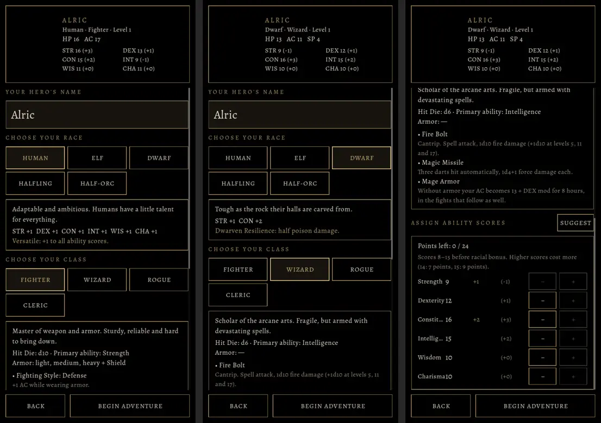
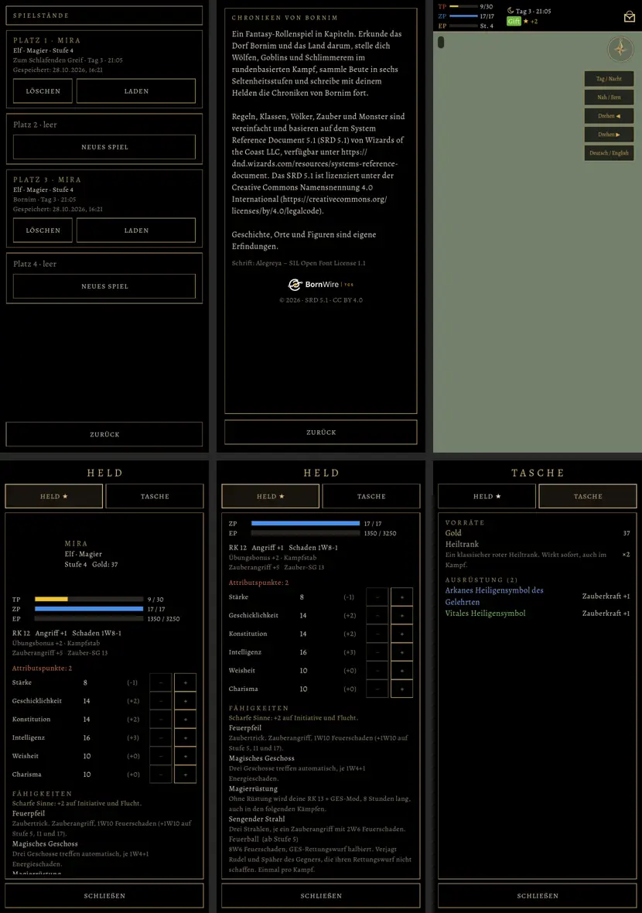

# 399.1 · Erschaffung, Spielstände, Leiste und Menü wie im alten Spiel · Tom · 28.10., 16:22

Kurz: Erschaffung, Spielstände, Über, Leiste oben und Menü (Held, Tasche) wie im alten Spiel (Proben am Rechner)

**Erschaffung (15:55):** eine Seite wie `CreateScreen.kt`. Oben fest Held und Werte (TP, RK, ZP, sechs Attribute); darunter Name, Volk (Beschreibung, Bonus, Merkmal), Klasse (Trefferwürfel, Hauptattribut, Rüstung, Fähigkeiten der Stufe 1) und Punktekauf mit Vorschlag; unten „Zurück“ und „Abenteuer beginnen“. Bilder: 1. Mensch, Kämpfer; 2. Zwerg, Magier; 3. Punktekauf.

**Spielstände, Über, Leiste, Menü (16:22)**, auf Test 132 hin („Gold … Trefferpunkte … Taschen … weiß ich alles nicht … es gibt ja kein Menü“). Oben: Spielstände (vier Plätze, Laden, Löschen, Neues Spiel in einen leeren), „Über das Spiel“, die Leiste oben (TP, ZP, EP mit Stufe, Mond oder Sonne, Tag und Uhr, Zustände, freie Punkte, rechts die Tasche). Unten: Menü „Held“ (Werte, Balken, Attribute, Punkte verteilen, Fähigkeiten) und „Tasche“ (Gold, Vorräte, Ausrüstung). Beispiel: Elfenmagierin Stufe 4, angeschlagen, vergiftet.

Am Rechner fehlt der Held auf dem Drehteller; im APK dreht er sich dort (wie alt). Stil-Abgleich: `DESIGN-STIL.md` „Oberfläche“ (Alegreya, schwarz, dünner Goldrand, Überschriften in gesperrten Goldversalien).

Noch offen: Aussehen in der Erschaffung (Geschlecht, Statur, Haut, Haar), bis der Held Varianten hat (Vorgang 376.1); im Menü die Reiter Ausrüstung, Karte, Chronik, System sowie Dinge benutzen und anlegen. Alles kommt mit Build 133.

**Was du sagen sollst:** ja, oder was anders sein soll.
