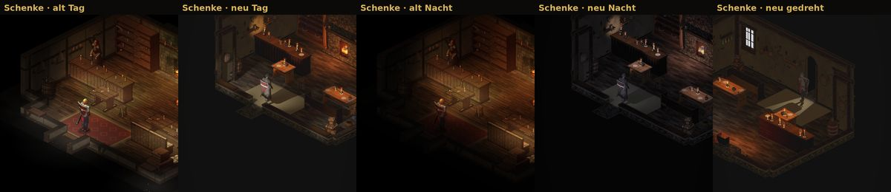
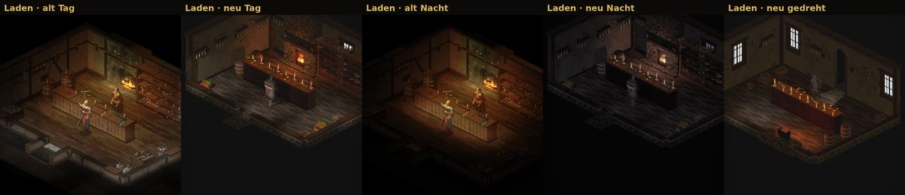
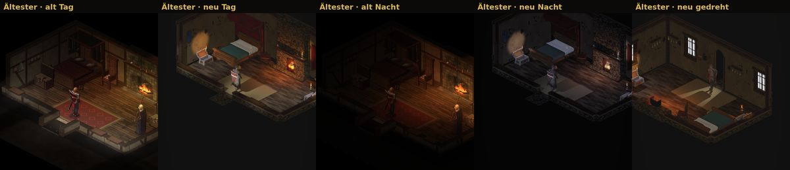
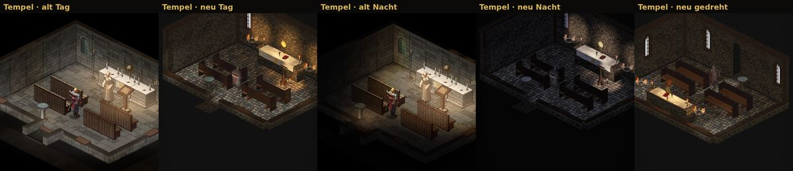

# 399.5 · Innenräume wie alt, dritter Stand · Tom · 29.10., 00:3x

Probe am Rechner, noch kein Build. Je Raum v. l. n. r.: alt Tag, neu Tag, alt Nacht, neu Nacht, neu um 180° gedreht. Ohne Leute (in der Probe nicht gebaut).

So gebaut: Wände, Fenster und Türen aus denselben Bausatzteilen wie das Haus draußen, an derselben Stelle; Einrichtung je Feld wie alt aus einem freien Möbelbausatz (CC0); Licht nur aus Quellen (Kamin, Kerzen, Leuchter; am Tag durch Fenster und Tür, nachts Mond).

Seit dem ersten Stand nach den Befunden des Prüfers geändert:
- Räume höher, die Tür jetzt 2,3 m (der Held ist 1,8 m).
- Theke: Platte in heller Eiche statt schwarz, auf jedem Feld eine Kerze und ein Stumpf, Licht je Feld wie alt. Im Laden auf der Theke Waage mit Münzen, Kontobuch, Tuchballen mit Schere.
- In allen Räumen hohe Regale, voll bestückt: Schenke Krüge und Flaschen, Laden Waren und Tuchballen, Ältester Bücher.
- Was hoch an einer Wand steht (Regal, Waffengestell, Wandbehang, Kleinkram auf Wandbrettern), verschwindet mit der Wand, wenn sie beim Drehen vorn ist. Vorher sah man Rückseiten über der Brüstung.
- Kräuterbündel an den Wänden, Bänke in der Schenke mit Lehne, Lesepult im Tempel weg von der Bank.
- Ältester: Himmelbett mit rotem Vorhang, roter Teppich wie alt. Tempel: Sonne auf dem Altar, grauer Quaderstein. Truhe in Holzfarbe, Weihwasser hell.
- Nachts etwas heller, Kerzen als Lichtinseln.
- Dritter Stand, nach dem Prüfer zum zweiten: Kerzen auf der Ladentheke hinten, Waage größer vorn; Ladenregal mit weniger, größeren Waren; Bänke in Eiche statt schwarz; Fass nicht mehr im Balken; Kräuter heller; Pfosten am Himmelbett; Altarsonne 40 cm; Teppich rot; Pult nicht mehr im Altar; gedreht kein Kaminblock und keine freie Flamme mehr.

Noch offen, gemessen: nachts weiter zu dunkel (neu 50–52 % des Tags, alt 44–64 %); mehr Grundlicht hilft kaum, die Ursache suche ich noch. Tempel bei Tag dunkler als alt (37 zu 51).

**Was du sagen sollst:** nichts nötig; ich baue weiter, dann neue Bilder, dann der Build mit 376.1.
