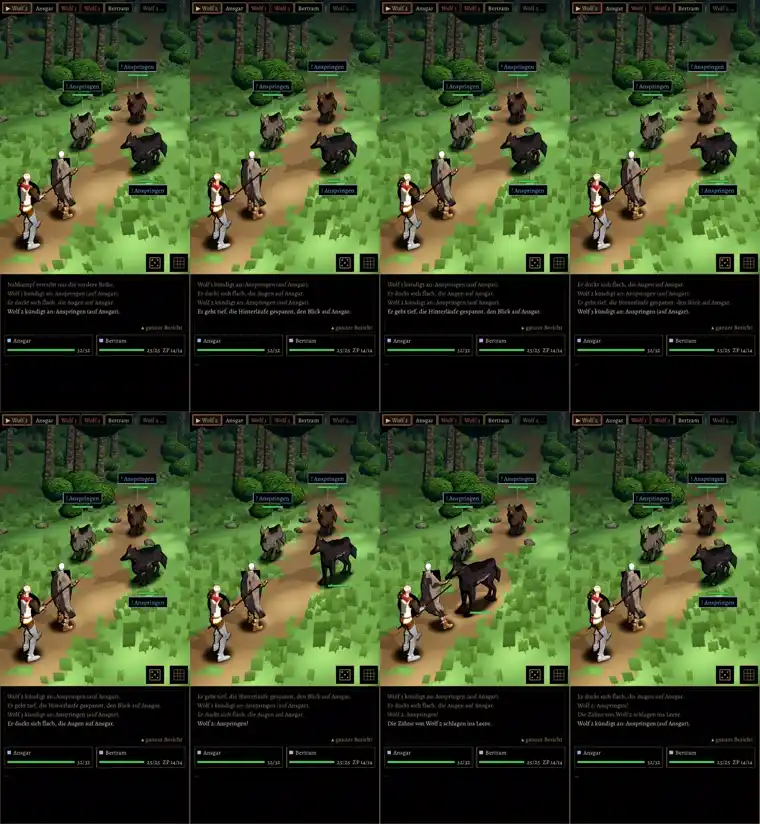

# 403 · Held im Kampfort wie im Dorf · Jerry · 31.10., 22:45 (Morgenblatt, nachts nur Technik)

[Film](bilder:pruefung/403-kampfheld.mp4), 44 s am Rechner, noch kein Build: erst Kämpfer als Held (Begleiter Kleriker), ab 0:22 Kleriker als Held (Begleiter Kämpfer), gegen das Wolfsrudel, Autopilot.

- Held und Begleiter im Kampf sind jetzt das Modell aus dem Dorf (Klasse, Tracht, Kopf, Haar, Haut); im Film Kämpfer und Kleriker, Schurke und Magier laufen im Test mit.
- Bewegungen: noch die bisherigen (Hieb, Stich, Treffer, Ausweichen, Abwehr, Tod), auf das neue Modell übertragen. Die Bewegungen aus der gekauften Bibliothek (UAL Pro: Hieb, Treffer, Tod, Ausweichen) liegen eingebaut bereit, aber noch nicht im Kampf; Vergleich folgt als eigenes Blatt.
- Er geht oder rennt zum Gegner, schlägt im Stand, geht rückwärts zurück (zu sehen beim Kämpfer, ab 0:09); vorher glitt er heran.
- In Ruhe hält der Kämpfer Schwert und Schild in Kampfhaltung vor dem Körper; von hinten sieht man den Schild zwischen den Schultern.
- Seit dem Film behoben: der Stab des Klerikers zeigte waagerecht auf den Nachbarn, jetzt senkrecht.
- Bekannt, nicht neu: bei „geht zu Boden“ fällt die Figur nicht; beim Schlag steht der Held etwas im Wolf.

**Zu sagen:** „passt“ (fährt mit den bisherigen Bewegungen im nächsten Build mit) oder was nicht stimmt.
