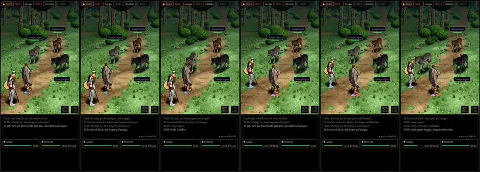

# 406 · Gewählte Schilde am Helden: 2 beim Kleriker, 15 beim Kämpfer · Jerry · 01.11., 11:55

[Film von 01.11., 11:54](https://cdn.jsdelivr.net/gh/tramour-cmyk/androidapp_rpg_bornim@bilder/2026-11/01-1154-406-Jerry.mp4) (eingetragen von meldung.sh, Jerry)

[Film](https://cdn.jsdelivr.net/gh/tramour-cmyk/androidapp_rpg_bornim@bilder/pruefung/406-kaufschilde.mp4), 32 s am Rechner mit Kaufheld und Kaufwolf, noch kein Build: erst der Kämpfer mit Schild 15, dann der Kleriker mit Schild 2, je 16 s gegen das Wolfsrudel, Autopilot, Echtzeit, gezeichnet wie im Spiel (Tusche nach Licht).

- **Schilde:** unverändert aus den Paketen (Omie Drachenschild, PolyMech offen rund), nur gedreht wie im Drehfilm und auf Größe gebracht: Drachenschild 72 cm hoch wie der bisherige Kampfschild, rund 60 cm wie der bisherige Rundschild. Farbe aus dem Paket.
- **Name passt zur Form:** der Kämpfer beginnt jetzt mit „Rundschild“, der Kleriker mit „Schild“ (vorher umgekehrt; gleiche Werte, gleicher Preis).
- **Unterwegs** hängt derselbe Schild auf dem Rücken; das zeigt erst der Build (dafür gibt es am Rechner kein Bild wie im Spiel).
- **Gemessen** (Ecken von Körper und Kleidung gegen die Schildfläche): im Kampf beim Kämpfer nie, beim Kleriker die Spitze unten beim Ausweichen bis 5 cm im Bein, 4 von 1600 Messbildern (vorher bis 6 cm in 9). Auf dem Rücken ragen Schulter und Oberarm bis 7–9 cm in die Oberkante (vorher 6,5–7 cm): Lage aus 376.1, an Tom gemeldet.
- Bestand geprüft: `LISTE-BESTAND.md` „Waffen und Schilde“, Schilde 2 und 15 genommen.

**Prüferbefund nach dem Versand (01.11., 12:0x), wichtig:** Der Film zeigt nicht, was er soll. Die Kamera steht hinter den Figuren, der Schild sitzt außen am linken Arm: man sieht nur seine Innenseite, den Rundschild 15 des Kämpfers gar nicht (verdeckt vom Körper), den Drachenschild 2 nur zur Hälfte (Spitze hinter der Hüfte), darum wirkt er eckig und klein (sichtbar etwa 52 cm). Sonst: Schild sitzt am Arm, folgt jeder Bewegung, geht durch nichts; Figur samt Schild springt bei 25,95 s in einem Bild in die Trefferhaltung; Wolfsschnauze 8–10 cm in Kopf und Schulter (8,8–9,4 s, 25,2–27,2 s; gehört zu 454). Vorschlag: neuer Film, beide Schilde von vorn und im Kampf von der Gegnerseite, im Spiellicht (Probeläufe 406 verbraucht, darum erst nach deinem Wort).

**Zu sagen:** „passt“ (fährt im nächsten Build mit) oder was nicht stimmt.
