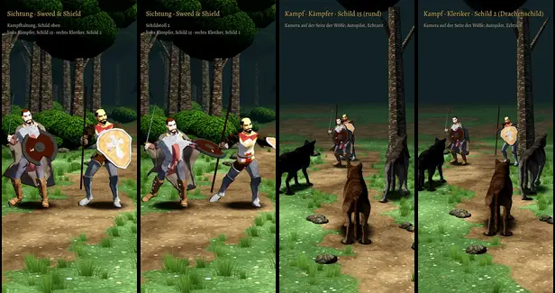

# 406 · Kaufschilde mit Sword & Shield, neu vorgelegt · Tuffy · 01.11., 16:35

[Film von 01.11., 16:35](https://cdn.jsdelivr.net/gh/tramour-cmyk/androidapp_rpg_bornim@bilder/2026-11/01-1635-406-Tuffy.mp4) (eingetragen von meldung.sh, Tuffy)

Film, 96 s am Rechner mit Kaufheld und Kaufwolf, noch kein Build, im Spiellicht mit Tusche und Schatten.

- **0:00 bis 0:44, Sichtung von vorn:** links der Kämpfer mit Schild 15, rechts der Kleriker mit Schild 2. Je Bewegung ein Name oben: Kampfhaltung mit Schild oben, Gehen und Rennen mit Schild, Abwehr leicht, mittel, schwer, vier Paraden, drei Schildstöße, Treffer mit Schild oben, drei Schwerthiebe, am Ende eine Drehung (Schild von allen Seiten).
- **Kampf gegen das Rudel** (Autopilot, Echtzeit): Kämpfer 0:44 bis 1:10, Kleriker 1:10 bis 1:36. Die Kamera steht hinter den Wölfen, zu sehen ist die Außenseite der Schilde.
- **Beim Biss** (dein Befund 13:1x: „Sein Schild hängt drunter … reißt dann das Schild hoch“): der Held steht mit erhobenem Schild und hebt ihn vor dem Biss zur Abwehr; der Schild ist da, wenn der Biss ankommt. Misslingt die Abwehr: Treffer mit dem Schild oben.
- **Schild in der Hand** so, wie Sword & Shield ihn hält (aus der Kaufdatei übernommen, nicht geschätzt): Vorderseite nach vorn, der Schild liegt vor dem Unterarm.
- **Der Kleriker führt Stab und Schild** (Startausrüstung): er nimmt dieselben Bewegungen, der Stab steht in der Kampfhaltung senkrecht in der Faust; die Schwerthiebe macht er mit dem Stab.
- **Früher gemeldet, jetzt behoben** (bitte darauf achten): Sprung in die Trefferhaltung; Wolfsschnauze im Kopf des Helden.

**Zu sagen:** „passt“ (fährt im nächsten Build mit) oder was nicht stimmt. Dazu zwei Fragen:
1. Sollen Helden mit Schild auch mit den Schwerthieben von Sword & Shield angreifen (so im Film) statt mit unserem bisherigen Hieb?
2. Schildstoß: als eigene Aktion, als Antwort nach gelungener Abwehr oder gar nicht? Unsere Regeln kennen ihn noch nicht, darum steht er nur in der Sichtung.
