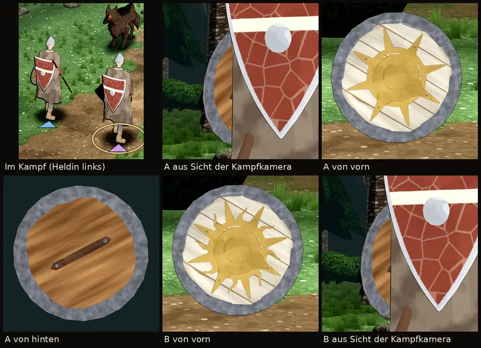

# 406 · Rundschild des Klerikers, erstes Stück der Ausrüstung · Jerry · 29.10., 07:54

Probe am Rechner im Kampfort (Licht, Tusche wie im Spiel), noch kein Build; Runde 3 nach den Prüferbefunden von 07:43 und 07:51. Oben links die Heldin im Kampf, daneben Fassung A aus Sicht der Kampfkamera, gerade von vorn, gerade von hinten; unten Fassung B von vorn und aus Sicht der Kampfkamera.

Wie alt (`Dress.kt`): helles Holz, goldene Sonne, Buckel vergoldet. Neu gegen „steril“: Form vom Rundschild des freien Bausatzes (Quaternius, CC0): gewölbte Bretter, eiserner Rand, Buckel mit Platte, acht Nieten und vier Klammern, Griff hinten. Unsere Bemalung: Farbe über der Holzmaserung, dunkle Fugen zwischen den Brettern, Abrieb am Rand; Sonne aus Ring und acht spitzen Strahlen in Richtung der Nieten; Buckel, Platte, Nieten und Klammern golden; Rückseite rohes Holz. 788 Dreiecke (Grenze 800); Farben dunkler gemalt, weil die Sonne im Kampfort sie etwa 1,5-fach aufhellt.

- **A:** acht Strahlen, wie alt.
- **B:** dazu acht kurze, gewellte Strahlen dazwischen.

Nicht von diesem Stück: im Kampf tragen Heldin und Söldner noch den alten roten Schild auf dem Rücken (altes Kampfmodell der Heldin, ersetzt mit 403); aus Sicht der Kampfkamera zeigt der Schild seine Rückseite, die Sonne sieht man im Dorf und im Menü.

Prüferbefund 07:58, noch nicht behoben (Technik, kommt mit deiner Wahl neu): Klammern als goldene Keile mit grauen Splittern, Buckel fast flach, Nieten wie Dellen, Außenrand eckig, innen Kerben, hinten Spalt zwischen Holz und Rand, unten links ein Keil rohes Holz vorn. Schild und Sonne stehen in der Hand um etwa 30° gedreht (folgt dem Unterarm).

Bestand geprüft: Fantasy Props MegaKit, Shield_Wooden genommen.

**Was du sagen sollst:** A oder B, oder was anders sein soll.
