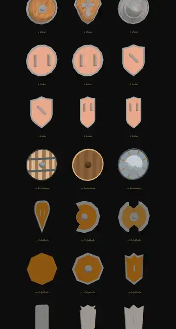

# 406 · Schilde der Bibliothek zur Wahl · Jerry · 31.10., 22:45 (Morgenblatt, nachts nur Technik)

[Film](https://cdn.jsdelivr.net/gh/tramour-cmyk/androidapp_rpg_bornim@bilder/pruefung/406-schilde.mp4), 8 s: alle 21 Schilde aus den gekauften Paketen, jeder dreht sich einmal ganz, gezeichnet wie Held und Söldner im Kampf (Archiv 408: „Chef wählt“). Gleich hoch gezeigt (60 cm); im Spiel bekommt der gewählte die Größe des Rundschilds.

- 1–3 Omie (Rund-, Drachen-, Faustschild), 4–9 Anker (A–F), 10–12 Avramania (Rund-, Holz-, Faustschild), 13–21 PolyMech (Drachen, zwei offene runde, rund Holz, rund Metallrand, Holz mit Rahmen, Eisen lang, Löwenherz lang und klein).
- Im ersten Bild zeigen manche die Innenseite (Pakete verschieden ausgerichtet); in der Drehung sieht man beide Seiten.
- 19 (Eisen lang) ist im Paket einfarbig grau.

**Zu sagen:** Nummer(n) für den Kleriker (bisher Rundschild hell mit goldener Sonne) und gern für den Kämpfer.
