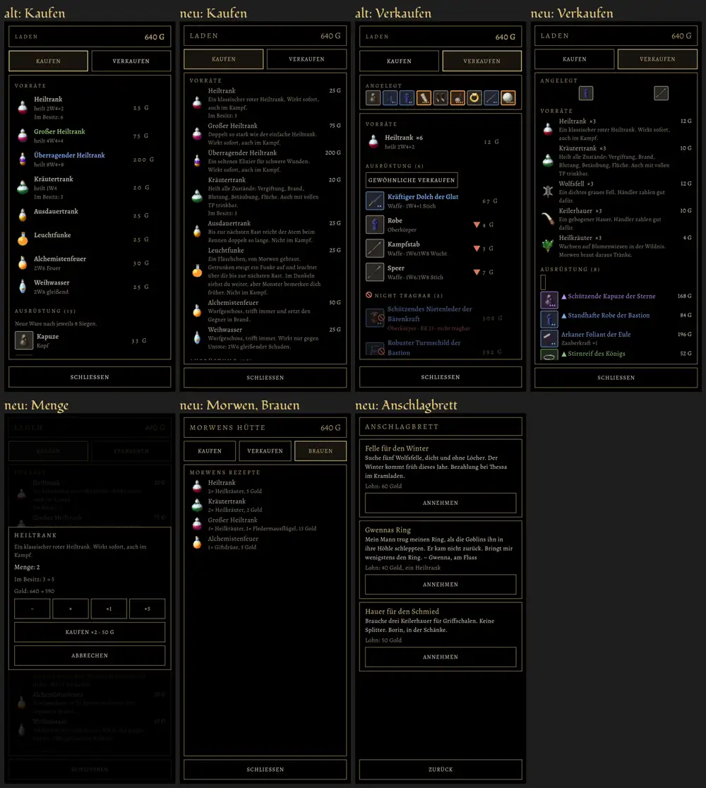

# 416.3 · Laden und Anschlagbrett bildschirmfüllend wie alt · Team Tom · 31.10., 22:07

Oben: alter Laden (Kaufen, Verkaufen) jeweils links, der neue daneben, gleicher Held wie in der alten Vorschau. Unten neu: Kasten für die Menge, Morwens Hütte mit Brauen, Anschlagbrett. Aufbau wie alt: oben Name und Gold, darunter Kaufen und Verkaufen, beim Verkaufen die angelegten Stücke als Leiste, Zeilen mit Bild, Werten und Preis rechts, unten Meldung und Schließen. Zweig `claude/tom-416-befunde`, fährt im nächsten Build.

**Bitte sagen: passt das Aussehen, oder was soll anders sein?**
