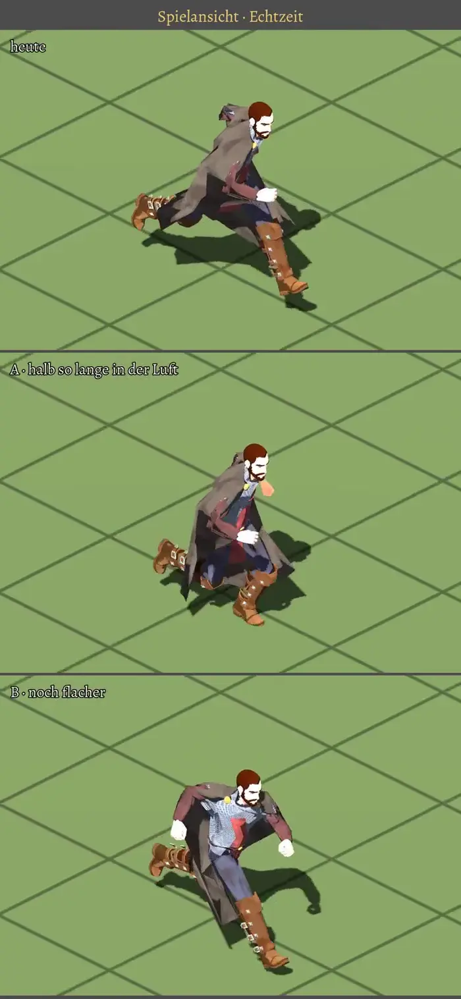

# 416.4 · Rennen: heute, A, B am Helden, wie er im Spiel läuft · Tom (Team Tom) · 01.11., 13:0x

[Film von 01.11., 13:02](https://cdn.jsdelivr.net/gh/tramour-cmyk/androidapp_rpg_bornim@bilder/2026-11/01-1302-416.4-Tom.mp4) (eingetragen von meldung.sh, Tom)

Film per Telegram (16 s, Hochformat): drei Felder untereinander, oben heute, darunter A und B. Erst die Spielansicht, dann von der Seite, dann von der Seite in halber Geschwindigkeit; Stehen, Gehen, Anlaufen, Rennen im Tempo des Spiels. Kämpfer auf dem Kaufkörper ohne Waffen. Noch kein Build; Zweig `claude/tom-416-4-rennen`, Ablauf `tom-probe-4164.yml`.

**Neu gegenüber Spikes Vorlage:** Im Spiel lief seit 376.1 der Kaufkörper mit der Bibliotheksbewegung unverändert; Spikes Fassungen wirkten nur auf den alten Helden. Jetzt sind A und B am Kaufkörper gebaut und hier zu sehen.

Gemessen im Spiel (Rennen 4,27 m/s):

| Fassung | Schritte je Sekunde | Schrittlänge | Becken hebt sich | Zeit ohne Fuß am Boden |
|---|---|---|---|---|
| heute | 1,7 | 2,53 m | 23,5 cm | 74 % |
| A | 2,7 | 1,59 m | 8,2 cm | 50 % |
| B | 3,1 | 1,40 m | 5,9 cm | 46 % |

Kein Fuß unter dem Boden, kein Gleiten. Erster Lauf hatte bei A und B den Fuß 2–3 cm im Boden; behoben, bevor der Film zu dir kam.

**Prüferbefund (13:1x, nach dem Versand):** kein Fuß im Boden, kein Gleiten gesehen; bei heute lange Flugphase (Füße über dem Schatten), A kürzer, B am flachsten. Als Erstes fällt der Saum des Wappenrocks auf: von der Seite eine harte dunkle Platte, die in Landung Knie und Oberschenkel durchsticht (alle drei Fassungen, Tracht des Kämpfers, nicht das Rennen). Bei heute in der Zeitlupe die Flugpose fast still, dann in zwei Bildern gelandet; bei 4,1 s dreht der Oberkörper in einem Bild, die Faust ist kurz orange.

**Frage:** heute, A oder B?
**Vorschlag Tom:** A. Ein Läufer bei diesem Tempo macht etwa 2,8 Schritte je Sekunde zu 1,5 m, das trifft A.
**Stärkstes Gegenargument:** Mit 417 Runde 4 (gerade in Arbeit, deine Pakete von 12:03) läuft der Held mit Waffe nach den Bewegungen aus den Paketen; A oder B gilt dann nur, wenn er nichts in der Hand hat (Stab und Fackel; jede Klasse beginnt mit Waffe). Ein Rennen ohne Waffe haben die Pakete nicht.

**Zu sagen:** „416.4 A“ (oder heute, B), dann fährt es im nächsten Build mit.
