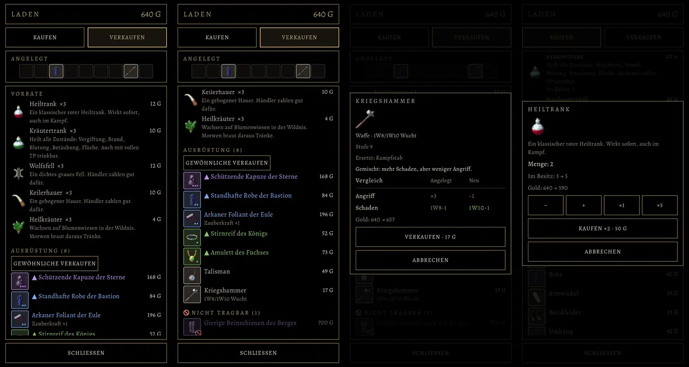

# 416.9 · Laden, Runde 2: Leiste fest, Leerzeile weg, Vergleich wie alt · Tom (Team Tom) · 01.11., 12:4x

[Bild von 01.11., 12:40](https://github.com/tramour-cmyk/androidapp_rpg_bornim/blob/bilder/2026-11/01-1240-416.9-Tom.png) (eingetragen von meldung.sh, Tom)

Von links: Verkaufen, Verkaufen nach unten gerollt, ein Stück angetippt, Kasten „Menge“ beim Kaufen. Gleicher Held wie in Runde 1 (Elfenmagierin). Bild aus dem Spiel auf GitHub (Lauf `tom-probe-4169.yml`), noch kein Build; Zweig `claude/spike-416-9-laden`, fährt im nächsten Build mit. Tests grün: Laden, Tasten, Bedienung, Skripte.

Nach deinem Wort von 11:30 und 11:32 gebaut (eine Fehlerprüfung des Bildes folgt als Text):
- **Leiste „Angelegt“ fest:** sie bleibt oben stehen, nur die Liste darunter rollt (Bild 2 nach unten gerollt).
- **Leerzeile unter Ausrüstung:** das war der Knopf „Gewöhnliche verkaufen“, auf 11 Pixel gequetscht und ohne Schrift. Jetzt in voller Höhe mit Schrift.
- **Vergleich wie alt:** Tabelle „Vergleich | Angelegt | Neu“, Zugewinn grün, Verlust rot; das kurze Urteil bleibt darüber (Bild 3). Gilt auch in Tasche und Ausrüstung.

**Prüferbefund (12:41, nach dem Versand):** Leiste steht in Bild 1 und 2 an derselben Stelle; „Gewöhnliche verkaufen“ lesbar, keine Leerzeile; Tabelle mit Urteil darüber, nichts abgeschnitten. Auffällig: das Verbotszeichen ragt über den Rand des Bildes und verdeckt die Stufenpunkte (Bild 2 unten, „Gierige Beinschienen“); „Stufe 9“, „Ersetzt: Kampfstab“ und die Kopfzeile „Angelegt“ schwach im Kontrast (Bild 3).

**Zu sagen:** „passt“ (dann in den nächsten Build) oder was anders sein soll.
