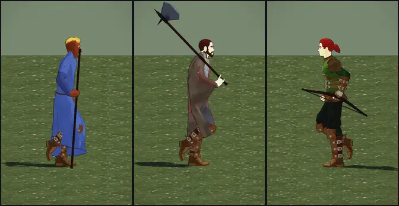

# 417 · Kriegsaxt in der Hand: Kopf nach unten, weiter vorn gefasst · Tom · 01.11., 12:08 (Runde 3)

[Film von 01.11., 12:06](https://cdn.jsdelivr.net/gh/tramour-cmyk/androidapp_rpg_bornim@bilder/2026-11/01-1206-417-Tom.mp4) (eingetragen von meldung.sh, Tom)

Film (von der Seite, Gehen und Rennen, drei Fassungen nebeneinander) und Blatt per Telegram, am Rechner, noch kein Build. Stab und Bogen wie in Runde 2 (passen, Chef 11:32).

- **bisher** (Runde 2): Schneide oben, am Stielende gefasst, Kopf hoch hinter der Schulter.
- **A:** Blatt hängt nach unten, Axt 25 cm weiter vorn gefasst. Blattmitte höchstens 41 cm über und 44 cm hinter der Schulter (Gehen), im Rennen 51 und 36 cm.
- **B:** Blatt hängt nach unten, 40 cm weiter vorn gefasst, Kopf dicht hinter der Schulter. Blattmitte höchstens 30 cm über und 33 cm hinter der Schulter, im Rennen 38 und 27 cm; das Stielende ragt dafür weiter nach vorn unten.
- Gemessen über einen ganzen Umlauf: in A und B nirgends im Körper; der Stiel liegt höchstens 1 cm tief auf der Schulter auf (schwebt nicht, wie Runde 2), nächster Abstand zum Oberschenkel im Rennen 7,8 cm (A) bzw. 4,2 cm (B).
- Bestand geprüft: Kriegsaxt `waffen.py` (eigenes Modell, wie Grak), Kämpfer auf dem Kaufkörper Regulär, Bewegungen der UAL genommen; kein Halter nötig.

**Zu sagen:** A oder B (oder bisher); dann die übrigen Waffen so und in den nächsten Build.
