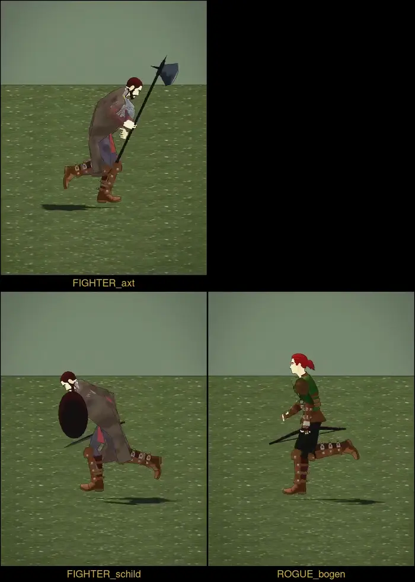

# 417 · Tragart, Runde 4: Gehen und Rennen aus den gekauften Paketen · Tom (Team Tom) · 01.11., 13:3x

[Film von 01.11., 13:34](https://cdn.jsdelivr.net/gh/tramour-cmyk/androidapp_rpg_bornim@bilder/2026-11/01-1334-417-Tom.mp4) (eingetragen von meldung.sh, Tom)

Film per Telegram (5 s, Raster 2 × 2): oben links Kriegsaxt, unten links Langschwert mit Rundschild, unten rechts Kurzbogen (Schurke); je 2,5 s Gehen, dann Rennen, im Tempo des Spiels, von der Seite der Waffe. Im Spiel gefilmt (Wiese, Toon-Licht, Tusche). Noch kein Build; Zweig `claude/tom-417-tragart`.

**Oben rechts schwarz:** Langschwert ohne Schild. Für dessen Rennen hat der Bau das Tempo nicht gemessen (0 m/s), die Bewegung lief darum im Film viel zu schnell. Ursache behoben, kommt im nächsten Lauf.

Nach deinem Wort von 12:21 („schwebt“) nicht mehr von Hand gestellt: Arm, Hand und Schritt kommen aus den Paketen, die Waffe sitzt in der Faust.

| Waffe | Gehen | Rennen |
|---|---|---|
| Kriegsaxt (Zweihänder) | WalkForwardNormal2HandMelee | Sprint2HandMelee |
| Langschwert | WalkForwardHold1hMelee | SprintHold1hMelee |
| Schwert und Schild | WalkForwardS&S | RunFastNormalS&S |
| Bogen | WalkBow | RunFastBow |

**Rennen anders als genannt:** Die genannten „Run…“ laufen von sich aus 1,3–2,7 m/s; im Spiel (4,27 m/s) hätten sie 4,8–8,5 Schritte je Sekunde gemacht. Genommen ist je Paket die Fassung, die von selbst etwa im Spieltempo läuft: 3,0–4,2 Schritte je Sekunde, Becken hebt sich 5–10 cm (heute 24 cm).
**Gehen:** wie genannt, aber die Pakete gehen langsam (0,7–0,8 m/s); im Spieltempo (2,13 m/s) 3,8–4,7 Schritte je Sekunde, heute 3,4.

**Frage:** passt die Richtung (Pakete, Waffe in der Hand)?
**Stärkstes Gegenargument:** Das Gehen der Pakete ist für unser Spieltempo zu langsam gemacht und wirkt im Film womöglich getrippelt. Abhilfe wäre ein langsameres Gehtempo im Spiel; das ist Spielgefühl und deine Entscheidung.

**Zu sagen:** „417 passt“ (dann Langschwert nachziehen und in den nächsten Build), oder was anders sein soll.
