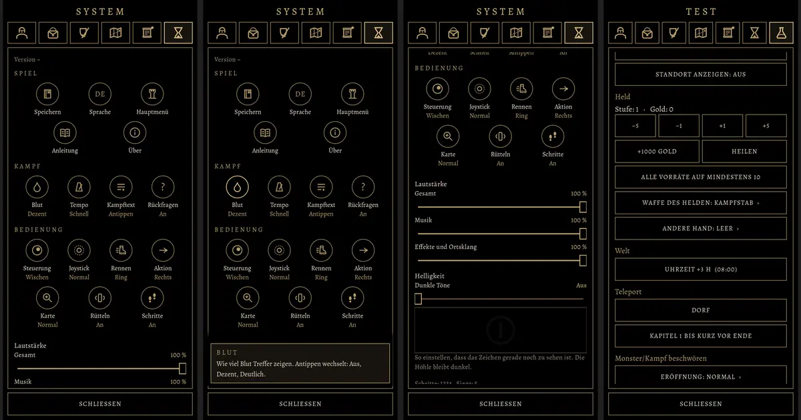

# 425 · Menü „System“ und Testmenü wie alt, Zeichen statt Text · Team Tom (Spike) · 31.10., 22:37

Von links: Menü „System“ oben; „Blut“ gedrückt gehalten, die Erklärung liegt über „Schließen“ (Antippen oder Zurück schließt sie); weiter unten Bedienung, Lautstärke, Helligkeit; Testmenü. System eins zu eins nach der alten Fassung (`MenuSigns.kt`): Kreis mit Zeichen, darunter Name und Wert, Antippen wechselt, Gedrückthalten erklärt; beim ersten Öffnen einmal „Halte ein Zeichen gedrückt, und es erklärt sich.“ Das alte Zeichen „M“ (MARS-Probe) fehlt noch, den Schirm dazu gibt es in Godot nicht. Testmenü: in der alten Fassung ohne Zeichen, nur Knöpfe; übernommen wie alt, gekürzt um die Geräteangaben (jetzt hinter „Gerät zeigen …“) und den Satz zu Wald und Höhle. Zweig `claude/spike-425-menues`, fährt im nächsten Build.

**Bitte sagen: passt das Aussehen? Soll das Testmenü auch Zeichen bekommen (alt hatte es keine)?**
