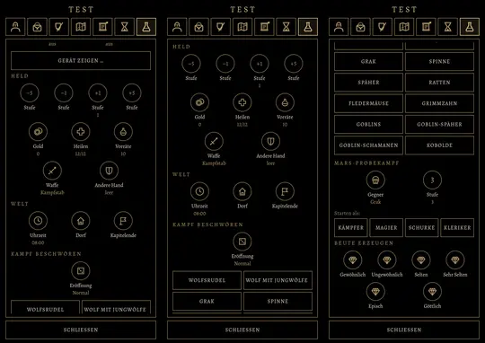

# 425 · Testmenü mit Zeichen · Tom · 01.11., 01:10

Bild per Telegram, am Rechner, noch kein Build.

- Jeder Eintrag ist jetzt ein Zeichen wie im Menü „System“: Name, Wert in Gold, Antippen tut es, Gedrückthalten erklärt.
- Neue Zeichen: Tacho (Bildrate), Stecknadel (Standort), Münzen (Gold), Kreuz (Heilen), Flasche (Vorräte), Schwert (Waffe), Schild (andere Hand), Uhr, Haus (Dorf), Fahne (Kapitelende), Würfel (Eröffnung), Schädel (Gegner), Edelstein (Beute je Seltenheit). Stufe −5, −1, +1, +5 als Zahlen im Kreis.
- Listen bleiben Knöpfe mit Namen, weil der Name dort der Inhalt ist: Waffen, Gegner zum Beschwören, Klasse beim Probekampf.

**Was fehlt gegenüber der alten Fassung** (Vorschlag Tom, je Punkt „ja“ oder „nein“):

| Nr. | Eintrag | wofür | Votum |
|---|---|---|---|
| 1 | Wald und Höhle im Teleport | gibt es in der neuen Welt noch nicht; kommen mit Wald und Höhle | ja, sobald es sie gibt |
| 2 | Monster beachten mich nicht | durch Gebiete laufen, ohne zu kämpfen | ja |
| 3 | Gegner bestehen keine Rettungswürfe, Held trifft immer kritisch | Zauber und Treffer sicher prüfen | ja |
| 4 | Variante „Schimmernd“ beim Beschwören | wartet auf Elite-Gegner in MARS | ja, mit MARS |
| 5 | Monster neben den Helden holen statt Kampf starten | Annähern und Kampfbeginn prüfen | ja |
| 6 | Bosse zurücksetzen (Krogg, Grak) | Bosskampf wiederholen | ja, sobald es die Höhle gibt |
| 7 | Regen, Kartenzoom, Sichtlinie | Wetter und Sicht gibt es neu noch nicht | später |
| 8 | neu: Tag oder Nacht sofort, Fackel an oder aus | Licht und Tusche nachts prüfen ohne Warten | ja |

**Zu sagen:** „passt“ (Zeichen so, fährt im nächsten Build mit) oder was anders sein soll; zur Liste die Nummern mit „ja“.
