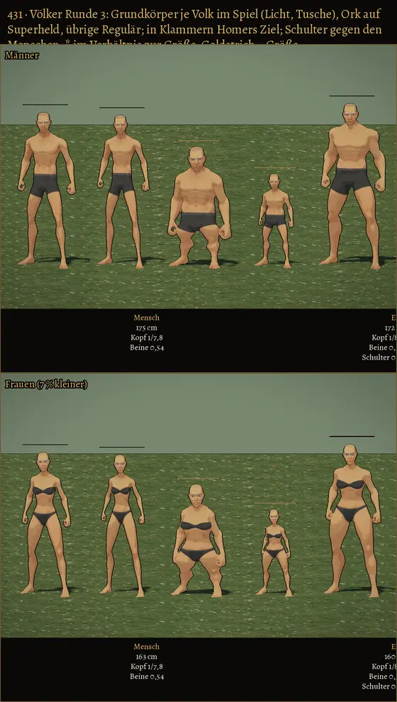

# 431 · Völker, Runde 3: Grundkörper je Volk im Spiel-Look · Tom (Team Tom) · 01.11., 13:3x

[Film von 01.11., 13:29](https://cdn.jsdelivr.net/gh/tramour-cmyk/androidapp_rpg_bornim@bilder/2026-11/01-1329-431-Tom.mp4) (eingetragen von meldung.sh, Tom)

Film per Telegram. Dritter Lauf, wie freigegeben (431a, 12:56); kommt so, wie er ausgefallen ist. Im Spiel gefilmt: Wiese, Toon-Licht, Tusche, Spielkamera, Ruhe wie der Held, drehend. Reihen: Männer, Frauen, Hügelvolk neben dem Menschen, Schattenriss von vorn und von der Seite. Noch kein Build; Zweig `claude/tom-431-voelker`.

Nach deinem Wort von 11:42 (Ork auf Superheld, die übrigen auf Regulär):

| Volk | Mann | Frau | Kopf : Körper |
|---|---|---|---|
| Mensch | 1,75 m | 1,63 m | 1 : 7,8 |
| Elf | 1,72 m | 1,60 m | 1 : 8,1 |
| Zwerg | 1,35 m | 1,26 m | 1 : 5,0 |
| Hügelvolk | 1,05 m | 0,98 m | 1 : 6,0 |
| Orkblütiger | 1,85 m | 1,72 m | 1 : 7,7 |

Schultern gegen den Menschen: Elf 0,88, Zwerg 1,06, Hügelvolk 0,61, Ork 1,20. Aschgeborene sind nicht im Film (kein eigener Körperbau gebaut, Regulär wie der Mensch); Zwerg auf beiden Körpern kommt im Größenfilm 455.2.

**Prüferbefund (13:3x, nach dem Versand):** alle Füße am Boden, keine Risse an Schultern, Hals, Hüfte, Händen, kein Zucken; Größen im Bild stimmen mit der Tabelle (Elf 0,98, Zwerg 0,78, Hügelvolk 0,60, Ork 1,06 des Menschen). Als Erstes fällt auf: die Beschriftung unten läuft rechts aus dem Bild, lesbar nur „Mensch“, die dritte Titelzeile halb abgeschnitten; die Höhenstriche schweben etwa 20 px über den Köpfen. Beim Zwerg die Unterschenkel von der Seite kantig, mit hartem Absatz am Knie.

Gegen Homers Ziel (430): Größe, Kopfanteil, Beinanteil (Elf 0,56, Zwerg 0,36, Hügelvolk 0,49) und Schulter je unter 1 % daneben (Hügelvolk-Schulter anteilig zur Größe 1,01). **Bestand geprüft:** Elfenohren und Hauer fehlen (Suche im Ablauf fand nur Speere); nächster Schritt nach 408 frei im Netz, dann Kaufvorschlag. (Spike, 13:4x; derselbe Film kam von Spike ein zweites Mal per Telegram.)

**Zu sagen:** „431 passt“ oder je Volk, was anders sein soll.
