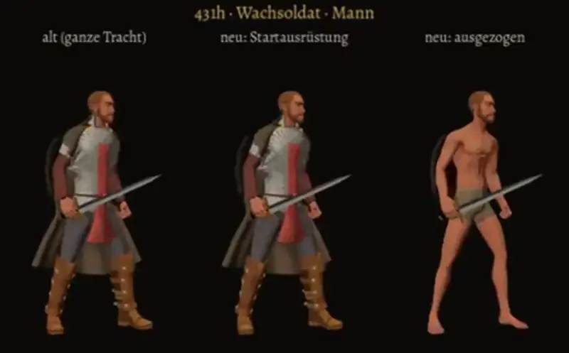

# 431h · Sichtbare Ausrüstung Stufe 1: jede Tracht aus Einzelteilen · Tom · 16.11., 18:50

[Film von 16.11., 18:46](https://cdn.jsdelivr.net/gh/tramour-cmyk/androidapp_rpg_bornim@film/20261116-184654-431h/2026-11/16-1846-431h-Tom-2.mp4) (eingetragen von meldung.sh, Tom)

[Film von 16.11., 18:46](https://cdn.jsdelivr.net/gh/tramour-cmyk/androidapp_rpg_bornim@film/20261116-184640-431h/2026-11/16-1846-431h-Tom.mp4) (eingetragen von meldung.sh, Tom)

E Leute · Tom · 16.11. · aus deinem Wort „431h A“ (10:08): Stufe 1 wie Vorlage, Film Drehteller alt gegen neu je Tracht, Start und ausgezogen

Geprüft an: Lauf 43903599534 (`claude/tom-431-ausruestung`, `69285b8a3`), Bauserver

Zwei Filme (Mann, Frau), je 15 s, alle fünf Herkünfte nacheinander. Je Tracht drei Figuren: links alt (ganze Tracht wie heute), Mitte neu (dieselbe Startausrüstung, jetzt aus Einzelteilen je Platz: Kopf, Oberkörper, Arme, Beine, Füße, Umhang), rechts neu ausgezogen (alle Plätze leer, Unterwäsche abgedunkelt).

**So soll es aussehen:** links und Mitte gleich. Stufe 1 ändert am Bild nichts, sie macht nur möglich, dass ein angelegtes Stück später sichtbar wird (Stufe 2).

Offen (eigene Prüfung, du urteilst):
- Oberkörper der vier Startstücke (Novizenkutte, Sammlerhemd, Schmiedehemd, Wanderhemd) tragen in Stufe 1 noch das Netz der heutigen Tracht, wie entschieden; der Klosterschüler sieht darum weiter gerüstet aus.
- Bilder je Sekunde am Handy nicht gemessen, nur Flächen und Dreiecke am Rechner.

👍 passt: Stufe 1 ins Spiel, dann Stufe 2 (fremde Stücke sichtbar) als Vorlage · 👎 falsch: mit Fund, ich stelle nach
