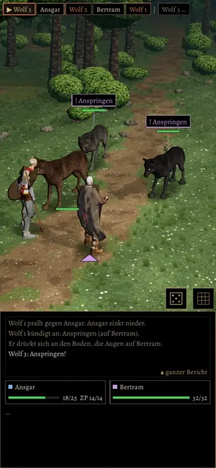

# 438, 439, 440 · Wölfe im Kampfort: nicht mehr ineinander, Kopf nicht im Helden, Tod knickt ein · Jerry · 01.11., 09:45

[Film](https://cdn.jsdelivr.net/gh/tramour-cmyk/androidapp_rpg_bornim@bilder/pruefung/438-woelfe-r2.mp4), 48 s am Rechner mit Kaufwolf und Kaufheld, noch kein Build: Kleriker als Held, Kämpfer als Begleiter, gegen das Wolfsrudel, Autopilot, Echtzeit, dieselben Würfel wie im ersten Film.

- **Wölfe ineinander:** Hauptursache war der Umriss des gekauften Helden in der Grundhaltung mit ausgestreckten Armen (1,8 m breit); jeder Wolf nahe der Gruppe stand so schon daheim „im“ Helden und nahm den am wenigsten schlechten Weg. Dazu galt der lange Wolf als Kreis, und ein Wolf drehte sich daheim in den Anlauf eines anderen. Gemessen (vier Kämpfe): vorher 72 Bilder über 10 cm ineinander, jetzt 0.
- **Kopf im Helden:** der Wolf beißt 6 cm weiter vorn ab, der Held bleibt beim Hieb 0,3 m vor dem Wolf; gemessen an den Knochen von Held und Söldner: 0.
- **Reihenfolge:** Würfelzeile, Schaden und Lebensleiste erst, wenn der Biss trifft; „… bricht zusammen“ steht in der Zeile, wenn er fällt; wer Platz macht, geht erst nach dem Biss.
- **Tod:** der Wolf knickt erst in den Läufen ein, dann fällt er (gleich lang wie bisher), liegt, verblasst.
- Drehsprünge der Wölfe und das ruckartige Heranzoomen der Kamera bei einem zweiten Schlag sind behoben.
- **Offen:** Der gekaufte Held hat kein Hinfallen und Aufstehen (Frage [438a](../entscheiden/438a-sturz-held.md)); Ansage und Leiste neben Wolf 1, Streifen unten: der Prüferbefund folgt in Telegram.

**Nachtrag 01.11., 10:55 (ohne neuen Film: die zwei Probeläufe bis zu deinem Urteil sind verbraucht):** die Prüferbefunde zum Film r2 sind behoben, gemessen mit `wolf_mess_438.gd` (vier Klassen, je 90 s, Handyformat; Commit 25408fbdd):
- „prallt gegen Ansgar“ steht mit dem Biss (vorher 3,7 s später); „sackt zusammen“ 0,4 s bevor er liegt (vorher 1 s danach).
- Sprung durch Bertrams Kopf: die Sprungbahn muss frei sein, sonst ein kurzer Satz aus der Nähe.
- Schnauze in Schild, Brust, Klinge: vorher bis 10 cm, jetzt 0, außer wenn der Held ausweicht (Stab bis 16 cm, 0,2 s).
- Wolf aus dem Bild: vorher bis 175 px; der Umweg bleibt im Bild, sonst geht die Linse weich ein Stück zurück; Rest 57 px für 0,7 s.
- Dreiecke verschwinden nur noch, wo eine Figur wirklich davorsteht; Ansagen und Leisten gleiten statt zu springen.
- Klinge durch den Wolf ohne Treffer: daneben bleibt der Held weiter weg, der Wolf weicht vor dem Hieb aus.
- Offen: einmal Wolf in Wolf 0,12 m (Schurke, 0,4 s). Neu zu entscheiden: [438b](../entscheiden/438b-ansagen-tempo.md) (Pausen bei den Ansagen), [438c](../entscheiden/438c-wolfsgroesse.md) (Größe der Wölfe).

**Zu sagen:** „passt“ (fährt im nächsten Build mit) oder was nicht stimmt; erst danach entsteht ein neuer Film (r3).
