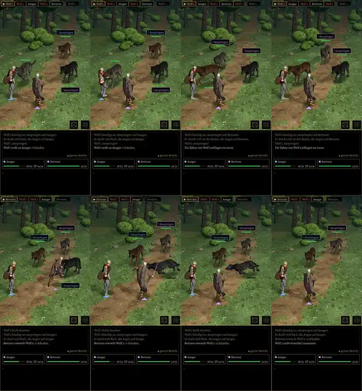

# 438, 439, 440 · Wölfe im Kampfort: Schritte statt Gleiten, Reihenfolge, Tod · Jerry · 01.11., 08:09

[Film](https://cdn.jsdelivr.net/gh/tramour-cmyk/androidapp_rpg_bornim@bilder/pruefung/438-woelfe.mp4), 48 s am Rechner, noch kein Build: Kleriker als Held, Kämpfer als Begleiter, gegen das Wolfsrudel, Autopilot, Echtzeit.

- **Ursache des Gleitens (438):** Die Bewegungen des gekauften Wolfs lagen falsch auf dem Modell; im Gehen hoben sich alle vier Pfoten zugleich, der Wolf schwebte. Jetzt wie in der Quelle: immer zwei Pfoten am Boden.
- Dazu: Wölfe fahren an und bremsen, die Schritte laufen im Tempo des Körpers, aufgesetzte Pfoten bleiben am Boden. Nach dem Biss geht der Wolf rückwärts heim, das Gesicht zum Helden, statt sich zweimal auf der Stelle umzudrehen. Einer vorn und einer hinten stehen schräg versetzt statt ineinander.
- **Reihenfolge (439):** Der Held stürzt erst, wenn der springende Wolf ihn trifft (vorher fiel er, als der Wolf schon wieder daheim stand). Fällt ein Wolf, rücken die anderen erst nach, wenn er liegt.
- **Tod (440):** Der Wolf fällt ganz (1,7 s), liegt gut eine Sekunde und verblasst dann; vorher war er nach 1,5 s weg. Im Film etwa ab 0:37.
- Gemessen ohne Bild (beide Kämpfe, je 90 s): Wolf in Wolf vorher 2519 Bilder, jetzt 25 (höchstens 0,24 m, beim Ausweichen); Drehen ohne Schritt vorher bis 20° je Bild, jetzt höchstens 8° mit Tritten.
- Bekannt, nicht neu: beim Biss steckt die Schnauze bis 0,3 m im Umriss des Klerikers (Schild und Waffe zählen mit); Ausweichen bleibt ein schneller Satz im Bogen.

**Zu sagen:** „passt“ (fährt im nächsten Build mit) oder was nicht stimmt.
