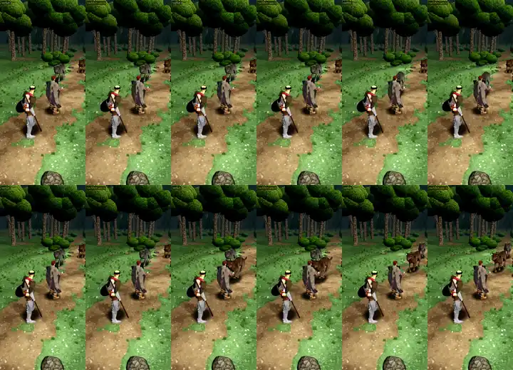

# 453.1 · Helden atmen ruhiger, jeder im eigenen Takt · Tuffy · 01.11., 14:19

Film, 24 s am Rechner mit Kaufheld und Kaufwolf, noch kein Build: links vorher, rechts nachher, gleiche Würfel. Kämpfer und Kleriker näher als im Spiel, damit man das Atmen sieht; erst 8 s Ruhe, dann Kampf auf Autopilot.

- **Ursache** (13:0x: „immer gleich atmen … hechelt“): die gekaufte Ruhebewegung atmet zweimal in 2,5 s (48 Atemzüge je Minute, Kopf nickt 4°), beide Helden starten sie im selben Augenblick.
- **Jetzt:** die Ruhebewegung bleibt stehen, das Atmen ist eine eigene Schicht nur auf Brust, Schultern und Hals. Held 3,8 s je Atemzug, Söldner 4,8 s (16 und 12 je Minute), versetzt; Schulter hebt sich 1 cm, Kopf neigt sich unter 1°.
- **Nach Angriff, Ausweichen, Treffer** schneller und tiefer (in den ersten 3 s 1,5-mal so schnell), nach etwa 6 s wieder ruhig.
- Atmen läuft auch unter Hieb und Treffer weiter; der Tote atmet nicht. Die Schicht passt auf jede Figur mit diesem Gerüst; die Wölfe bekommen ihr Atmen in 453 r2, der Wechsel zwischen Ruhebewegungen kommt mit den Sword-&-Shield-Bewegungen (406).

**Zu sagen:** „passt“ (fährt im nächsten Build mit) oder was anders sein soll (langsamer, flacher, deutlicher).
