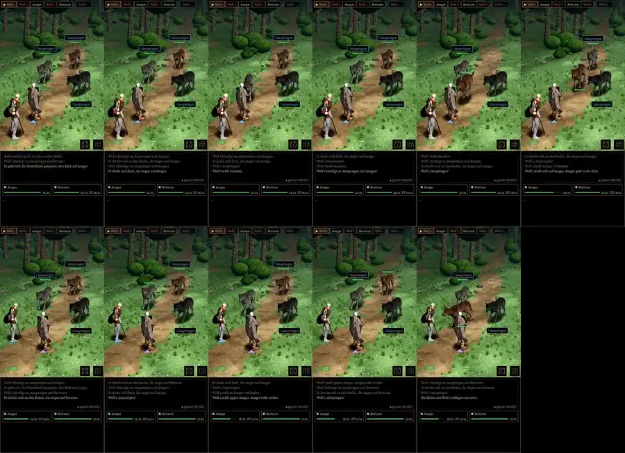

# 454 · Wolfsbiss: Achse und Schnauze aufs Ziel · Jerry · 01.11., 12:54

Film, 44 s am Rechner mit Kaufheld und Kaufwolf, noch kein Build: erst der Kämpfer, dann der Kleriker, je 22 s gegen das Wolfsrudel, Autopilot, Echtzeit.

- **Du hattest recht** (11:05: „dass die gar nicht auf dem Helden geht … rechts daneben“): der gekaufte Biss schlägt den Kopf seitlich, erst 11 cm nach rechts, dann 18 cm nach links. Damit die Schnauze im Augenblick des Zubeißens trifft, drehte das Spiel den ganzen Wolf 8,5° weg; danach wischte der Kopf links vorbei, am Schirm rechts neben den Helden.
- **Jetzt:** der Seitenschlag ist am Hals herausgerechnet, Ausholen, Strecken und Nicken bleiben wie gekauft. Der Wolf steht beim Biss gerade zum Ziel.
- **Gemessen** (16 Bisse, Kämpfer und Kleriker): Achse des Wolfs im Mittel 0,6° neben dem Ziel (vorher 1–9°), Schnauze höchstens 4 cm neben der Linie zum Ziel (vorher bis 26 cm). Bei Fehlbissen bleibt die Schnauze wie bisher 30 cm vor dem Helden, sichtbar daneben.
- Sonst nichts verändert; Messlauf Durchdringung und Gleiten wie vorher.

**Zu sagen:** „passt“ (fährt im nächsten Build mit) oder was nicht stimmt.
