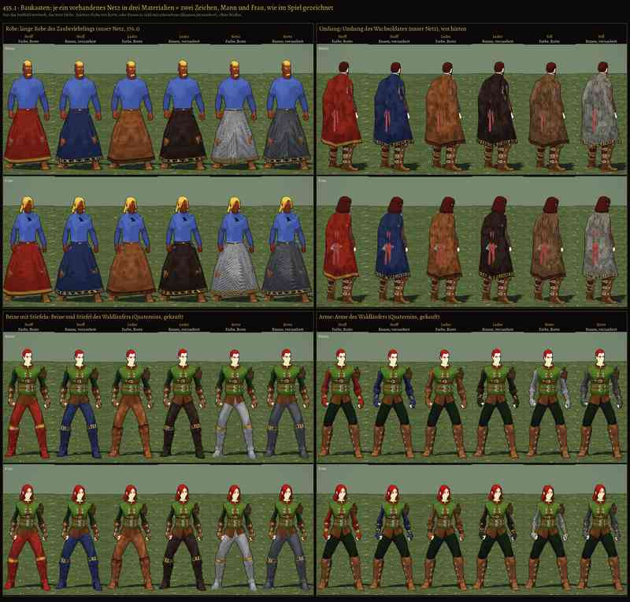

# 455.1 · Baukasten: je ein Netz in drei Materialien × zwei Zeichen · Spike · 01.11., 17:01

[Bild von 01.11., 17:00](https://github.com/tramour-cmyk/androidapp_rpg_bornim/blob/bilder/2026-11/01-1700-455.1-Spike.png) (eingetragen von meldung.sh, Spike)

Großbild: Telegram 01.11., 17:01. Wie im Spiel gezeichnet (Toon-Licht, Tusche, Wiese), ohne Waffen; noch kein Build. Ablauf `spike-probe-4551.yml`, Lauf 41322602607, Zweig `claude/spike-455-1-baukasten`.

- **Was** (Archiv 455, Chef 11:24 „Abzug von … unterschiedlichen Roben, Umhängen oder Stiefeln“): vier Netze nur aus dem Bestand, kein Eigenbau. Robe: lange Robe des Zauberlehrlings (unser Netz, 376.1). Umhang: der des Wachsoldaten, von hinten. Beine mit Stiefeln und Arme: Waldläufer (Quaternius, gekauft). Je Spalte ein Gegenstand, oben Mann, unten Frau.
- **Material:** Stoff, Leder, Kette (Robe, Beine, Arme); beim Umhang Fell statt Kette. **Zeichen:** „Farbe, Borte“ (Grundfarbe mit Borte am Saum, Stiefelrand, Handgelenk) und „Runen, verzaubert“ (dunkler, Runen in Gold mit schwachem Glimmen; Gold ist der einzige Glanz, Kette glänzt wie das Kettenhemd).
- **Wie gebaut:** das Netz bleibt, nur das Farbbild wechselt (ein Bild je Gegenstand, 1024 Punkte); so würde jeder Gegenstand später gebaut. Netzliste je Platz: `LISTE-NETZE.md` (455.2).
- **Stärkstes Gegenargument:** in der Spielansicht (weiter weg als hier) lesen sich Borte und Runen kaum; dort tragen nur Umriss und Farbe.

**Zu sagen:** „passt“ oder was anders sein soll (Material, Farbe, Borte, Runen); welche Materialien fehlen (Schuppe, Platte).
