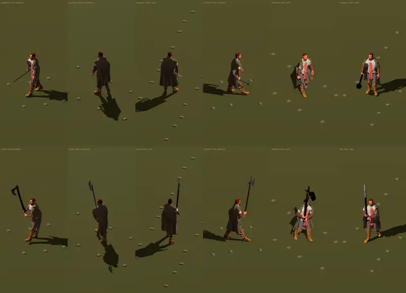

# 458.3 · Waffenstaffel im Spiel: Form nach Stufe, Farbe nach Seltenheit am Helden

Spike · 18.11., 00:20 · aus 458.3 (dein Wort 01.11.: „Staffel nach Stufe, Seltenheit über Material und Zeichen“; 02.11.: Modelle und Staffel passen)
Kurz: Die 45 Formen aus den Kaufpaketen (Omie, Anker, Avramania) werden im Bau fürs Spiel gebaut und hängen am Helden: 18 Waffenarten, Form nach Stufe des Gegenstands, Farbe nach Seltenheit. Zwei Filme mit dem gehenden Kämpfer.

Geprüft an: https://github.com/tramour-cmyk/androidapp_rpg_bornim/commit/3ae151786 (Bau am Rechner mit Kaufmodellen: „STAFFEL OK 45 von 45“; Test waffen_522: jede Form mit Länge, Griff und Farbe gut)

**Bild:** je Waffe ein Standbild aus den Filmen, oben Film 1, unten Film 2. **Film 1:** Langschwert Stufe 1, 5, 11; Streitkolben 1, 8; Morgenstern 11. **Film 2:** Großaxt 1, 5, 11; Hellebarde 1, 11; Speer 11. Oben links stehen Waffe, Stufe und Seltenheit.

**So gebaut:** Griff in der Faust und Länge wie in der alten Fassung (Speer 2,1 m, Hellebarde 1,76 m, Langschwert 88 cm). Höchstens 800 Dreiecke je Waffe (Modellregel 7): 18 Omie-Formen sind dafür vereinfacht. Die Form richtet sich nach der Stufe des Gegenstands, nicht nach der Stufe des Helden: ein gefundener Streitkolben behält seine Form, wenn der Held aufsteigt. Gewöhnliche Waffen haben immer die Stufe ihrer Grundform, sind also immer die schlichte Form.

**Offen:** Episch (Schwarzstahl) liest sich fast schwarz. Der Effekt für episch und höher statt Färbung (dein Wort 02.11.) ist ein eigener Schritt. Rapier und Zauberstab haben noch kein Modell, weil der Bestand keine Form dafür hat. Für die Leute im Dorf und den Kampfort ändert sich nichts. Prüfpunkte selbst geprüft: E1 (Waffe in der Faust, je Art anders) gut, E3 (nichts durch etwas) gut, G4 nur teils: jede Waffe einmal, nicht dreimal, damit alle Stufen in 15 s passen. Die Signatur fehlt: die Filme zeigen die Drehteller-Wiese wie 499, nicht das Dorf (A2 nicht geprüft). Ein Dorffilm wie im Spiel mit Tusche und Spielkamera nah liegt bereit (`tests/film_staffel_4583.gd`) und läuft erst nach deinem Urteil (eine Probe je Vorgang).

👍 so in den Sammelbuild · 👎 falsch
