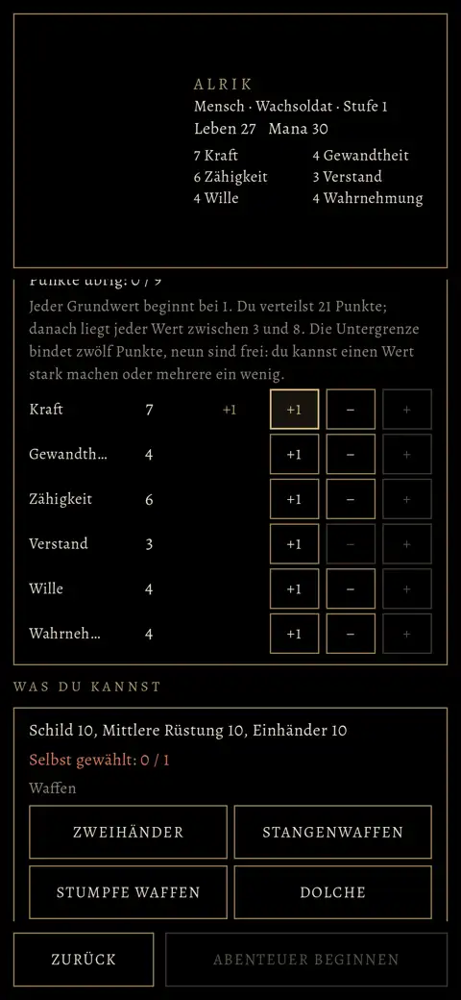

# 470 · Erschaffung nach BRS 1.1: Seite „Neues Spiel“ · Spike (Team Tom) · 02.11., 14:5x

[Bild von 02.11., 14:57](https://github.com/tramour-cmyk/androidapp_rpg_bornim/blob/bilder/2026-11/02-1457-470-Spike.png) (eingetragen von meldung.sh, Spike)

Bilder per Telegram (Bildlauf am Rechner, ohne Heldenmodell, darum links leer). Noch kein Build; Zweig `claude/spike-470-erschaffung`.

- Aufbau wie die alte Seite: oben der Held und Name, Volk · Herkunft, Leben, Mana, die sechs Grundwerte; darunter Name, **Dein Volk** (fünf Völker, Satz aus dem Handbuch, Plus und Minus), Aussehen, **Herkunft, wenn du willst** (sieben und Wanderer), **Die sechs Grundwerte** (Punkte übrig n / 9, je Wert − und +; beim Menschen „+1“ für den freien Punkt), **Was du kannst** (Startfertigkeiten der Herkunft mit 10, eigene Wahl je Gruppe: Wanderer zwei, Mensch eine mehr).
- „Abenteuer beginnen“ geht erst, wenn alle Punkte verteilt und alle Fertigkeiten gewählt sind.
- Zahlen aus der Datendatei der Simulation 444; Herkunft verteilt vor wie dort gerechnet (Spalte „21“). Texte wortgetreu aus Homers Handbuch.
- Nach dem zweiten Bildlauf noch behoben, nicht im Bild: Namen der Grundwerte ungekürzt, das Minus des Elfen bei Zähigkeit 3 sichtbar, Minuszeichen statt Bindestrich.
- Offen: wie der Held bis 2.3 kämpft ([470a](../entscheiden/470a-bruecke-bis-2-3.md)); Bergbau zur Wahl erst ab Kapitel 2.

**Prüferbefund (14:5x, nach dem Versand):** Seite passt in die Breite, Goldrand rechts wie links; Werte und Punkte stimmen in sich; als Erstes fällt auf: „Abenteuer beginnen“ ist gesperrt, ohne dass man oben sieht, warum (Hinweis „Punkte übrig“ bzw. „Selbst gewählt“ steht weiter unten); der Knopf „Tiere beruhigen“ ist 7 px breiter als die anderen. Stilfragen des Prüfers am Handbuchtext („ein Merkmal, das man merkt“; „kleinen Nachteil“, den der Mensch nicht hat): wortgetreu übernommen, nicht geändert.

**Zu sagen:** „470 passt“ oder was anders sein soll.
