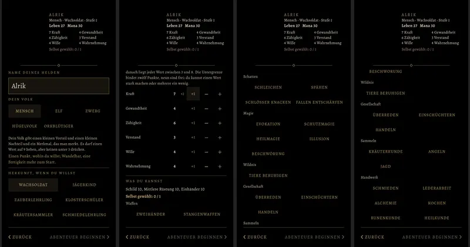
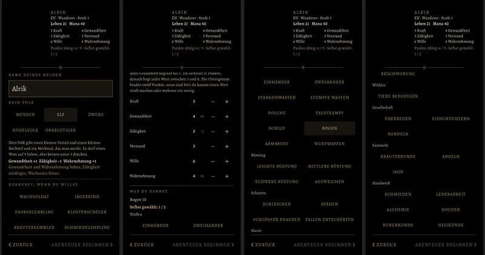

# 470 · Seite „Neues Spiel“ nach BRS, ohne Kasten · Spike · 10.11., 13:27

[Bild von 10.11., 13:28](https://github.com/tramour-cmyk/androidapp_rpg_bornim/blob/bilder/2026-11/10-1328-470-Spike.png) (eingetragen von meldung.sh, Spike)

Volle Größe per Telegram. „Neues Spiel“ (Hauptmenü und leerer Spielstand) führt jetzt in diese Seite: Volk, Herkunft, Grundwerte, Fertigkeiten; die alte Klassenwahl (Kämpfer, Magier, Schurke, Kleriker) ist weg. Aufbau wie die alte Seite nach der Regel „Fenster und Schirme ohne Kasten“: eine Zierlinie unter dem Kopf, Abschnitte durch Linien, Wahlfelder ohne Rahmen, unten „‹ ZURÜCK“ und „ABENTEUER BEGINNEN ›“, gedämpft, bis alles verteilt und gewählt ist (oben im Kopf steht, was noch fehlt). Unter „Aussehen“ wieder Geschlecht und Statur wie auf der alten Seite.

Geprüft an: https://github.com/tramour-cmyk/androidapp_rpg_bornim/tree/8f43379c9

Offen: der Held im Drehteller fehlt nur am Rechner (dort keine 3D-Modelle), im Spiel steht er da. Beim Menschen steht in der Zeile des gewählten Werts zweimal „+1“ (Bonus des Volks und das Wahlfeld „+1“). Im Kopf bricht „Selbst gewählt: 1 / 2“ in eine zweite Zeile um. Ins Spiel kommt die Seite erst nach bestandenem Test 274.18 (Kampf mit dem BRS-Helden), so entschieden am 10.11., 12:58.

Sag „470 passt“ oder was nicht passt.
