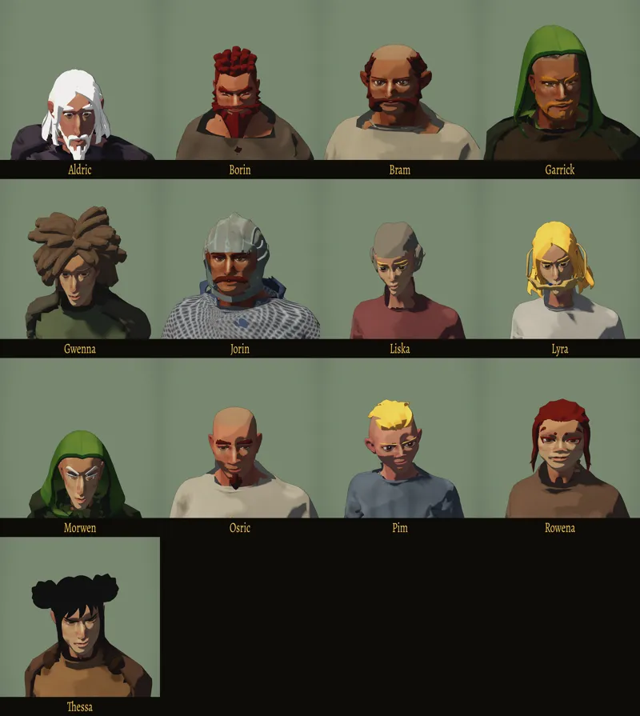

# 475 · Gesichter der Leute, Lauf 2 · Tom · 10.11., 02:07
Tom · 10.11., 02:07 · E Figuren
Kurz: Leute des Dorfs mit eigenem Gesicht auf dem Kaufkörper, Lauf 2 nach deinen Auflagen vom 04.11.

Großbild und Spielgröße: Telegram 10.11., 02:0x.

**Sag:** „passt“ oder was nicht passt.

- Auflagen vom 04.11., am Bild geprüft: jeder Mann eine andere Bartform (Aldric lang; Borin breit; Bram Backenbart; Garrick kurz; Jorin Schnauzer; Osric Kinnbart; Pim bartlos): ja. Borin und Bram an Brauen, Nase, Augen verschieden: ja. Garrick, Jorin, Liska, Morwen: Gesicht frei von Kapuze, Helm, Tuch: ja. Grün der Kapuze am Kinnrand: Ursache gemessen (bei Morwen schob die Gesichtsform den Hals durch die Kapuze), behoben.
- **Offen:** Lyras Stirnreif hängt vor dem Mund; Brauen bei hellem Haar (Morwen, Liska, Pim, Lyra) sind zu hell; Morwens Hals unter dem Kinn im Schatten fleckig grün (andere Stelle als der Kinnrand). Tusche: in Spielgröße ist der Umriss sichtbar, Linien im Gesicht kaum.
- Herkunft: Kaufkörper, Köpfe, Haare, Kapuze und Helm aus dem Bestand; Gesichtsformen und Kleidung eigen.
- Lauf am Rechner 10.11., 02:06, Renderer wie am Handy.

Geprüft an: https://github.com/tramour-cmyk/androidapp_rpg_bornim/commit/fd6b7421f

Antwort:
