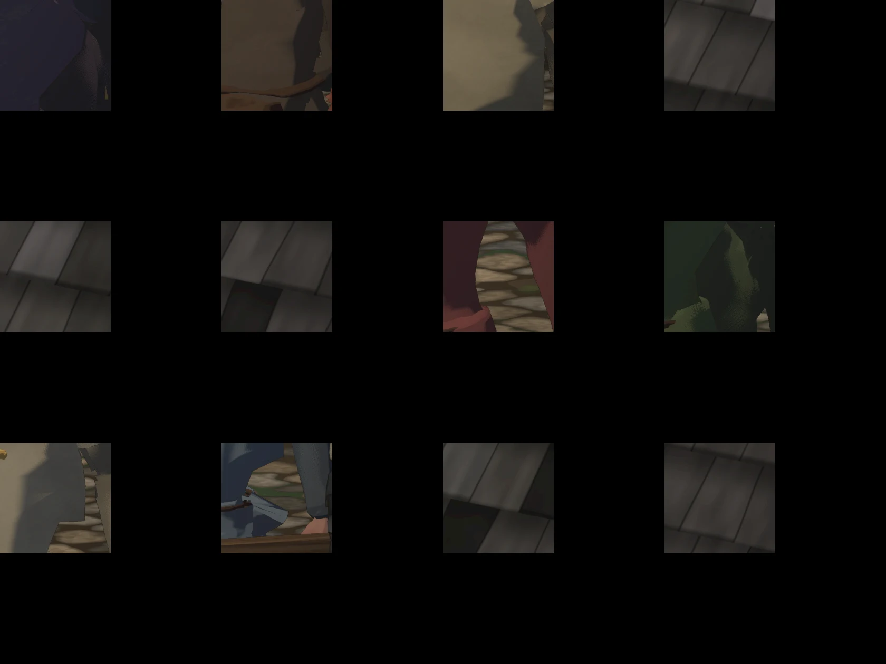

# 475 · Gesichter der Leute im Dorf auf dem Kaufkörper · Team Tom · 04.11., 06:3x

A Spiel
Kurz: Du hast gefragt (03.11., 07:45, 07:47), ob bei Rowena, Borin und den anderen „noch was kommt“, und wolltest jeden mit eigenem Gesicht statt dem Standardgesicht des Volks. Alle zwölf Leute im Dorf und in der Schänke stehen jetzt auf dem gekauften Körper, mit eigener Kopfform, Frisur, Bart, Haut- und Haarton und ihrer Kleidung. Bild: je Person der Kopf mit der Spielkamera, Licht und Tusche wie im Spiel, Name darunter. Lyra fehlt, sie steht in der Höhle.
Geprüft an: Lauf 260 (https://github.com/tramour-cmyk/androidapp_rpg_bornim/actions/runs/41772474417, Bildlauf 2 von 2; Zweig `claude/tom-475-leute`, Commit 7c06a8c6b). Lauf 1 (258) zeigte keine Köpfe (Ausschnitt falsch, Dächer davor) und ging nicht an dich.
Bestand geprüft: Körper, Köpfe, Haare und Bärte aus den gekauften Paketen (Universal Base Characters, Modular Character Outfits), Helm und Kapuze aus den Kauftrachten; nichts selbst gebaut außer Schürze, Schal, Kopftuch, Reif.

Was der Prüfer gefunden hat (04.11., 06:37), noch nicht behoben:
- Garrick und Morwen: die grüne Innenseite der Kapuze scheint durch Wangen, Mund und Kinn; bei Morwen ist das Gesicht kaum zu sehen.
- Liska: das Kopftuch sitzt über Mund und Kinn statt auf dem Kopf, oben ist der Kopf frei.
- Jorin: ein blaues Stück Untergewand scheint durch das Kettenhemd; das Visier ist zu, sein Gesicht und der Schnurrbart sind nicht zu sehen.
- Aldric hält den Kopf stark gesenkt, Kinn und Bart liegen unter dem Bildrand; bei Morwen ebenso Mund und Kinn.
- Pim wirkt erwachsen, nicht wie ein Kind.
- Bram und Osric haben fast dasselbe Gesicht (Augen, Brauen, Nase, Mund), sie unterscheiden sich nur durch Bart und Haar.

Bitte ansehen:
1. **Richtung:** stimmt die Richtung (eigene Gesichter auf dem gekauften Körper), dann behebe ich die Funde oben ohne neue Frage.
2. **Gesichter:** welches Gesicht passt nicht zu seiner Person? Ein Wort je Name genügt.

Großbild: Telegram 04.11., 06:3x
