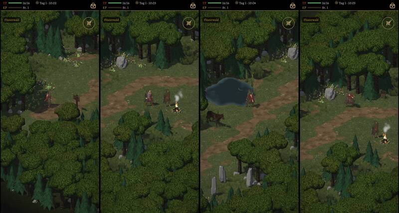
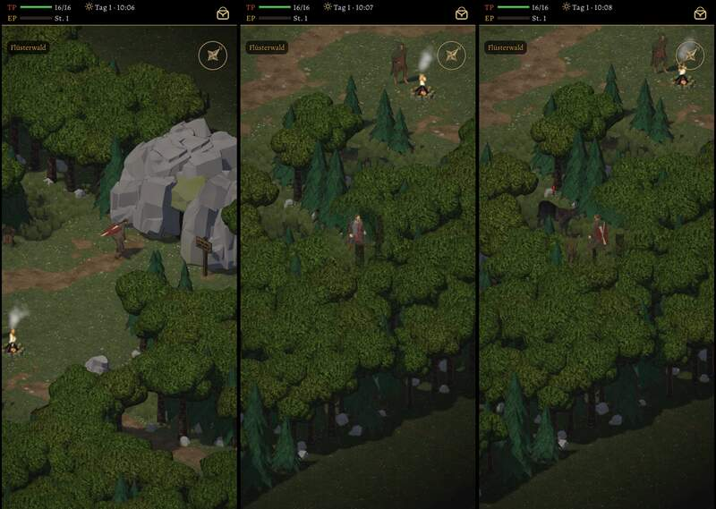
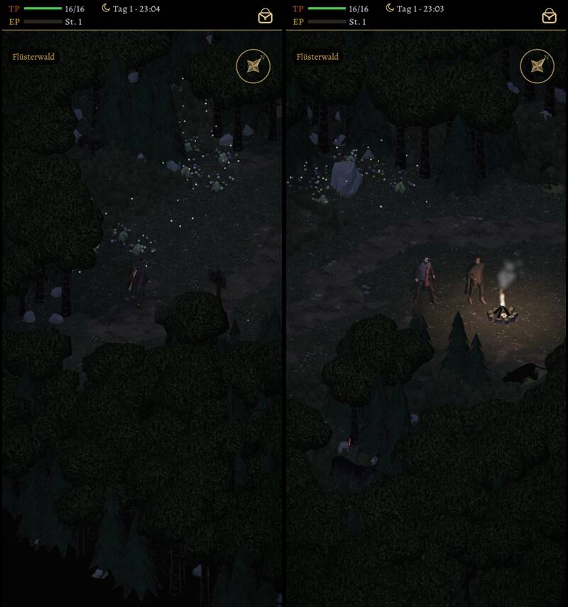

# 490 · Flüsterwald begehbar wie alt: Standbilder aus Sicht des Helden · Team Tom (Spike) · 03.11., 08:58

O Orte
Kurz: Flüsterwald als Gebietskarte, Lauf 2 von 2
Geprüft an: https://github.com/tramour-cmyk/androidapp_rpg_bornim/actions/runs/41596768637 (Lauf 2, Commit 08012e1b2; Lauf 1 war eine Fehlzählung des Zählers, kein Bild)

Großbild: Telegram 03.11. 08:59

**Zu sehen:** Der Weg aus dem Dorf führt jetzt in den Flüsterwald als begehbare Karte statt in einen Kampf. Bilder von links: Ankunft vom Dorf, Garrick am Feuer, Teich, Blumenwiese mit Heilkräutern, Höhlenmund, Ostrand, ein Wolf, der den Helden bemerkt; nachts Ankunft und Feuer. Spielbar und getestet (ohne Bild): Monster auf der Karte (bis 7, nur auf hohem Gras, am Feuer sicher), Angriff von nah und Überfall von hinten, Sieg: Monster weg, kommt später wieder; Truhen einmal; Kräuter pflücken bis zum nächsten Tag; Rast am Feuer; Höhlenmund als Tür; Weg zurück ins Dorf. Ohne Feinarbeit (Orte O6).

**Prüfer (03.11., 08:58), Fehler aus den Bildern:**
- Wolf und eine Figur mit Rundschild stehen halb in einer Tanne (Bild Wolf, Bild Kräuter); ein Tier am Rand des Feuerbilds halb im Gras.
- Am Ostrand steht der Held mitten im Laub, ein Stamm setzt seine Beine fort; unten rechts eine dunkle, leere Fläche: das Kartenende ist zu sehen.
- Höhlenmund: grauer glatter Fels ohne sichtbare Öffnung; an ihm, an Menhiren und Steinen fehlt die Linie am Umriss.
- An Laubkronen und am Fell der Wölfe ist keine Linie am Umriss zu erkennen (wie im Dorf und im Kampf).
- Nachts bei der Ankunft fast alles schwarzgrün, Held nur als Umriss.
- Unter dem Helden am Ostrand und unter dem Wolf kein Schatten; das „!“ ist klein.

**Stärkstes Gegenargument:** Mit diesen Fehlern ist der Wald noch nicht „Ort fertig“; begehbar ist er, die Bilder zeigen die Feinarbeit, die danach kommt.

**Bestand geprüft:** Bäume, Felsen, Büsche aus dem Naturbausatz (CC0) wie im Dorf; Garrick aus unseren Leuten; Monster wie im Kampf; nichts neu.

**Nachtrag Sokrates (03.11., 14:01):** Dein Hinweis 10:22: Karte lässt sich drehen und zoomen, verdeckte Wege durch Kronen sind kein Befund. Monster auf der Karte: Wolf (Kauf), Goblins (CC0), Ratte (Kauf); Fledermaus fehlt noch (510), Wildschwein, Hundertfüßer folgen mit 494.

**Zu sagen:** „490 passt“ (begehbar, Fehler oben danach), oder was anders sein soll.

Erledigt: Antwort ins Vorgangsarchiv, Datei löschen (Spike).
