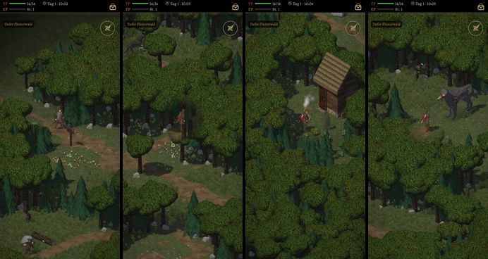
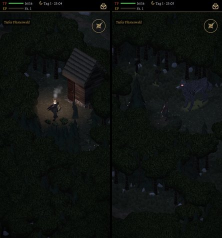

# 491 · Tiefer Flüsterwald begehbar wie alt: Standbilder aus Sicht des Helden · Team Tom (Spike) · 03.11., 10:05

[Bild von 03.11., 10:05](https://github.com/tramour-cmyk/androidapp_rpg_bornim/blob/bilder/2026-11/03-1005-491-Spike.png) (eingetragen von Spike)

O Orte
Kurz: Tiefer Flüsterwald als Gebietskarte, Lauf 2 von 2
Geprüft an: https://github.com/tramour-cmyk/androidapp_rpg_bornim/actions/runs/41603258384 (Lauf 2, Commit 9995c72d8)

Großbild: Telegram 03.11. 10:05

**Zu sehen:** Vom Flüsterwald nach Osten geht es jetzt in den Tiefen Flüsterwald als begehbare Karte. Bilder von links: Ankunft, Weg zwischen den Bäumen, Morwen an ihrem Feuer vor der Hütte, Grimmzahn vor seinem Platz; nachts Morwen und Grimmzahn. Spielbar und getestet (ohne Bild): Morwens Gespräch mit Laden und Brauen, Hütte verschlossen, Grimmzahn angesprochen: Erzählung, dann Kampf mit Leibwache, besiegt ist er fort; Monster auf der Karte (bis 13, nur auf hohem Gras), an Morwens Feuer sicher; vier Truhen; Weg zurück. Sicht: Loch im Laub um den Helden weiter als im Flüsterwald, Bäume am Weg rücken ab (Lauf 1: Held halb unter Laub, Weg voraus verdeckt). Ohne Feinarbeit (Orte O7). Die Karte hat 891 000 Flächen; ob sie am Handy flüssig läuft, zeigt erst der Test am Gerät.

**Prüfer (03.11., 10:04), Fehler aus den Bildern:**
- Weg: ein Stamm verdeckt das Bein des Helden, Kronen verdecken den Weg voraus; trotz der Änderung nach Lauf 1 nicht frei.
- Weg: ein Wolf oben links steckt mit Kopf und Hals im Baum, grau verwaschen, ohne Linie und Schatten, am Bildrand abgeschnitten.
- Morwen: die untere Bildhälfte ist ganz Laub.
- Ankunft: links unten eine braune Gestalt im Baumstamm, nicht erkennbar.
- Morwen ist einfarbig olivgrün, ohne Gesicht und Hände; nachts nur ein dunkler Umriss.
- Nachts bei Grimmzahn ist der Held nur ein Umriss.
- Laubkronen und Felsen ohne Linie am Umriss (wie im Flüsterwald).
- An Morwens Feuer keine Feuerstelle, die Flamme sitzt hinter dem Kopf des Helden; nachts helle Lichtkreise unter Wolf und Wache ohne Lichtquelle.
- Als Leibwache Grimmzahns ist nur eine Figur zu sehen; der Wegweiser zeigt Flecken statt Schrift.

**Stärkstes Gegenargument:** Mit den Fehlern oben ist der Tiefe Wald noch nicht „Ort fertig“; begehbar ist er, die Feinarbeit kommt danach wie beim Flüsterwald.

**Bestand geprüft:** Bäume und Felsen aus dem Naturbausatz (CC0) wie im Flüsterwald; Morwen aus unseren Leuten; Grimmzahn wie im Kampf; nichts neu.

**Zu sagen:** „491 passt“ (begehbar, Fehler oben danach), oder was anders sein soll.

Erledigt: Antwort ins Vorgangsarchiv, Datei löschen (Spike).
