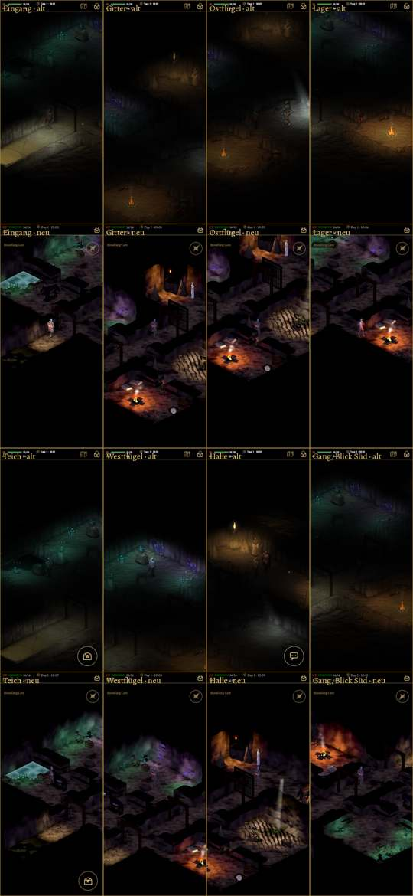

# 492 · Blutzahnhöhle: alt gegen neu an acht Stellen · Team Tom · 03.11., 23:3x

O Orte
Kurz: neue Vorlage nach deinem „abgleichen“ (16:30–16:33), Lauf 2 von 2; je Stelle oben alt, darunter neu.
Geprüft an: https://github.com/tramour-cmyk/androidapp_rpg_bornim/commit/bc11f77ed (Lauf 2 am Rechner, Held ohne Kaufmodell; Test hoehle_492 ohne Fehler; Strahltest: Brust des Helden nirgends verdeckt, Knie an 4–8 Kacheln je Drehung)

Großbild: Telegram 03.11. 23:3x

**Zu sehen:** dieselben acht Stellen der Höhle, der Held auf derselben Kachel, oben die alte Fassung, darunter die neue.

**Abgleich je Punkt deiner Worte:** folgt nach dem Prüfer (Text).

**Gemessen (Helligkeit der Bildpunkte, 0–255):** Lauf 1 war ein Drittel des Bildes genau 15/16/15 statt schwarz (die Kontrastsenkung hob das Schwarz an und drückte das Licht); jetzt schwarz 62–70 % der Fläche (alt 65–75 %), hellstes Zehntel ab 44–53 (alt 30–43).

**Zu sagen:** „492 passt“ (Feinarbeit danach), oder was anders sein soll.

Erledigt: Antwort ins Vorgangsarchiv, Datei löschen (Tom).
