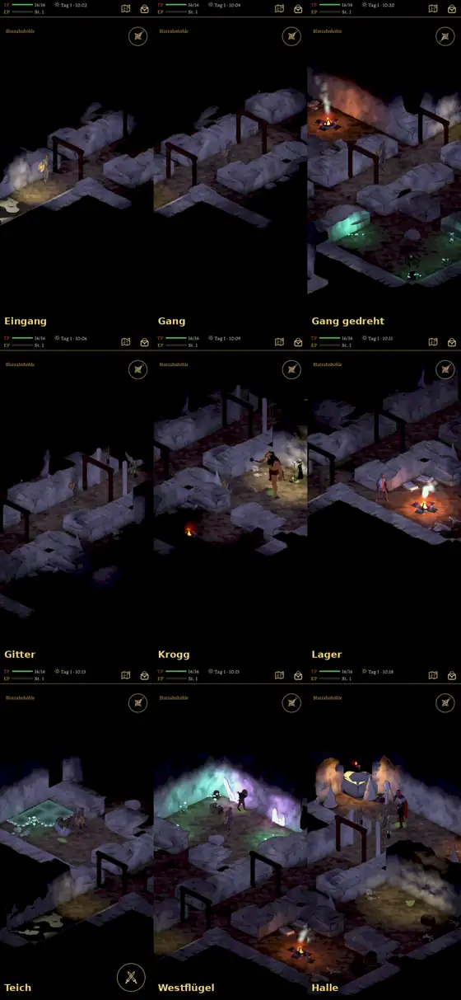
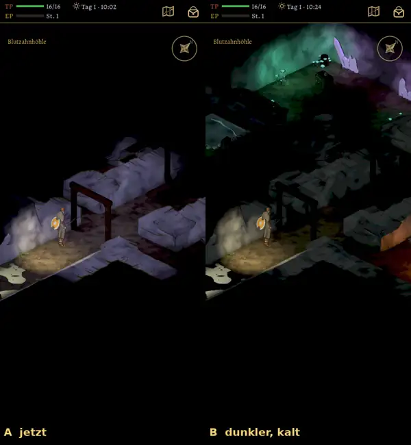

# 492 · Blutzahnhöhle: Fels und Licht · Tom · 08.11., 21:15

[Neun Stellen, 21:16](https://github.com/tramour-cmyk/androidapp_rpg_bornim/blob/bilder/2026-11/08-2116-492-Tom.png) · [Eingang A und B, 21:16](https://github.com/tramour-cmyk/androidapp_rpg_bornim/blob/bilder/2026-11/08-2116-492-Tom-2.png) (Tom)

Neu seit deinem Urteil „Betonwanne“ (04.11., 19:20; [Bild von damals](https://github.com/tramour-cmyk/androidapp_rpg_bornim/blob/bilder/2026-11/03-2330-492-Tom.png)): Die Felswände sind oben fast schwarz, am Fuß dunkler, mit Mulden, Rissen und nassen Bahnen, weich schattiert statt aus Kacheln. Der Held geht den echten Weg, was er schon gesehen hat, ist abgedunkelt.

Zur Wahl steht Fassung B mit schwächerem, kaltem Licht im ganzen Raum; Licht kommt dann nur von Fackel, Feuer und Kristallen. Wegen eines Fehlers im Bildwerkzeug gibt es B nur vom Eingang; bei den übrigen Stellen sprang das Spiel in das Gespräch mit Grak, so dass kein Bild der Höhle entstand. Das Werkzeug ist behoben, B von allen Stellen erst mit der nächsten Aufnahme.

Befund des Prüfers vor dem Versand (19:29): Licht ohne Quelle in Gang, Gitter und Eingang; Wände grob gerastert in Halle, bei Krogg und im Westflügel; im Lager eine Gestalt am Bildrand. Danach behoben: Wände weich schattiert. Licht ohne Quelle: in B behoben, in A offen. Offen: Lager.

Gesehen, nicht Teil von 492: Der Kampf gegen Grak findet noch im Wald statt; die Kampforte der Höhle baut Jerry (Vorgang 507).

Geprüft an: https://github.com/tramour-cmyk/androidapp_rpg_bornim/commit/ac9698a49 (Zweig `claude/tom-492-durchspiel`)

Was du sagen sollst: „492 passt, A“, „492 passt, B“ oder was nicht passt.
