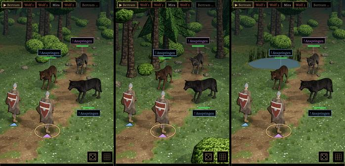
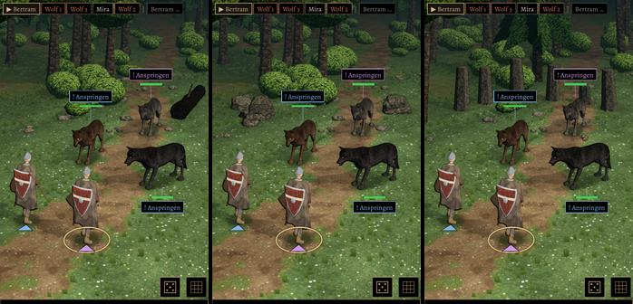

# 493 · Kampforte im Wald wie alt: Lichtung, Waldrand, Teich, Baum, Felsen, Steinkreis · Team Tom (Spike, von Jerry übernommen) · 03.11., 10:37

[Bild von 03.11., 10:37](https://github.com/tramour-cmyk/androidapp_rpg_bornim/blob/bilder/2026-11/03-1037-493-Spike.png) (eingetragen von meldung.sh, Spike)

O Orte
Kurz: sechs Kampforte im Wald, Lauf 2 von 2
Geprüft an: https://github.com/tramour-cmyk/androidapp_rpg_bornim/actions/runs/41606989973 (Lauf 2, Commit 56bcf0ead)

Großbild: Telegram 03.11. 10:37

**Zu sehen:** Derselbe Probekampf (Held und Söldner gegen das Wolfsrudel) an den sechs Orten des alten Spiels; je Ort steht, was ihn ausmacht, hinter dem Kampf oder an seiner Seite: am Waldrand stehen die Bäume näher, ein Teich mit Schilf, ein umgestürzter Stamm, Felsblöcke (aus dem Naturbausatz), sechs stehende Steine im Bogen. Welcher Ort kommt, wählt das Spiel nach dem, was auf der Karte um den Helden steht (Wasser, Steine, Stamm, Felsen, viele Bäume, sonst Lichtung; getestet ohne Bild). Die Lichtung ist unverändert. Lauf 1 hatte Stamm, halben Steinkreis und einen Felsen außerhalb des Bildes; behoben.

**Prüfer (03.11., 10:36), Fehler aus den Bildern:** Alles, was den Ort ausmacht, ist ganz im Bild und steht auf keinem Kämpfer.
- Baum: der Stamm ist fast schwarz, kein Moos zu sehen, kein Schatten darunter.
- Steinkreis: kein Schatten unter den Steinen; ein Stein halb so hoch (abgebrochen, gewollt); die Steine sehen aus wie gekappte Stämme.
- Felsen: Schatten darunter kaum zu sehen.
- Teich: Wasser einfarbig, ohne Spiegelung, harte Kante zum Gras.
- Waldrand: links stehen die Bäume viel näher, in der Mitte nur wenig; unten rechts ein kantiger Busch unter den Knöpfen.
- An allen Orten liegen auch Büsche und Steine im Hintergrund etwas anders als auf der Lichtung.

**Stärkstes Gegenargument:** Die Orte unterscheiden sich nur hinter dem Kampf; wer auf die Kämpfer schaut, sieht oft dieselbe Lichtung. So war es auch im alten Spiel.

**Bestand geprüft:** Felsen aus dem Naturbausatz (CC0, Chef: „Felsen ja“); Stamm, Teich, Schilf, stehende Steine selbst gebaut; nichts gekauft.

**Zu sagen:** „493 passt“, oder welcher Ort anders sein soll.

Erledigt: Antwort ins Vorgangsarchiv, Datei löschen (Spike).
