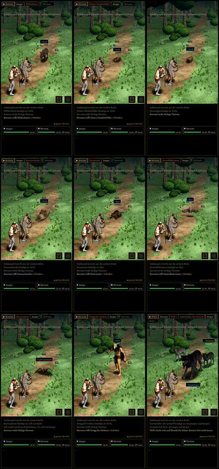

# 494 · Gegner von Kapitel 1 im Kampf, Bild aus dem Spiel · Team Jerry · 05.11., 11:2x

[Bild von 05.11., 11:26](https://github.com/tramour-cmyk/androidapp_rpg_bornim/blob/bilder/2026-11/05-1126-494-Jerry.jpg) (eingetragen von meldung.sh, Jerry)

Großbild: Telegram 05.11., 11:2x.

Kurz: neun Kämpfe im Kampfort, wie du sie im Spiel siehst (Spielkamera mit Kampfschirm, 2 s nach Kampfbeginn), der Held mit Söldner. Oben: Wildschwein, Riesen-Hundertfüßer, Riesenegel; Mitte: Säureschnecke, Riesenratte, Riesenfledermaus; unten: Riesenspinne, Krogg, Grimmzahn mit zwei Wölfen. Alle aus dem Kauf mit unseren Häuten. Kein Build zum Installieren: der Build (Lauf 266) läuft noch, die Testbitte kommt danach.

Zu prüfen: Passen die neun Gegner so ins Spiel (Aussehen, Größe neben dem Helden)?

Bekannt: Der Riesenegel bewegte sich in diesem Lauf nicht (die Bewegungen aus dem Kauf wurden nicht gefunden, behoben, kommt mit Lauf 266). Die Ansage heißt bei Keiler, Egel, Schnecke und Krogg noch „Stich“ (mit den Regeln des BRS, 478). Die Nahbilder halte ich zurück: Grimmzahn war dort ohne Kopf im Bild (Prüfer), der Ausschnitt ist für den nächsten Lauf korrigiert.

Prüferbefund (fremder Helfer, 05.11., 11:2x, vor dem Versand): alle neun ganz im Bild, jeweils das genannte Tier, auf dem Boden (Fledermaus fliegt), Tuschelinie und Schatten da, Größen neben dem Helden plausibel; Toon-Stufen nur bei Fledermaus und Krogg sicher erkennbar; Kroggs Umhang und Morgenstern fast reines Schwarz; bei Grimmzahn liegt der Lebensbalken des linken Wolfs über seinem Gesicht; Bestand geprüft: `LISTE-BESTAND.md` Kauf 348.12c (Keiler Janpec, Hundertfüßer MadeCG, Egel Game Ready Studios, Schnecke und Spinne Protofactor, Krogg mit Bärenkopf Janpec), Ratte, Wolf Kauf; Fledermaus die eigene bis 510.

Geprüft an: https://github.com/tramour-cmyk/androidapp_rpg_bornim/actions/runs/41999236882

Antwort: „494 passt“ oder was nicht passt.
