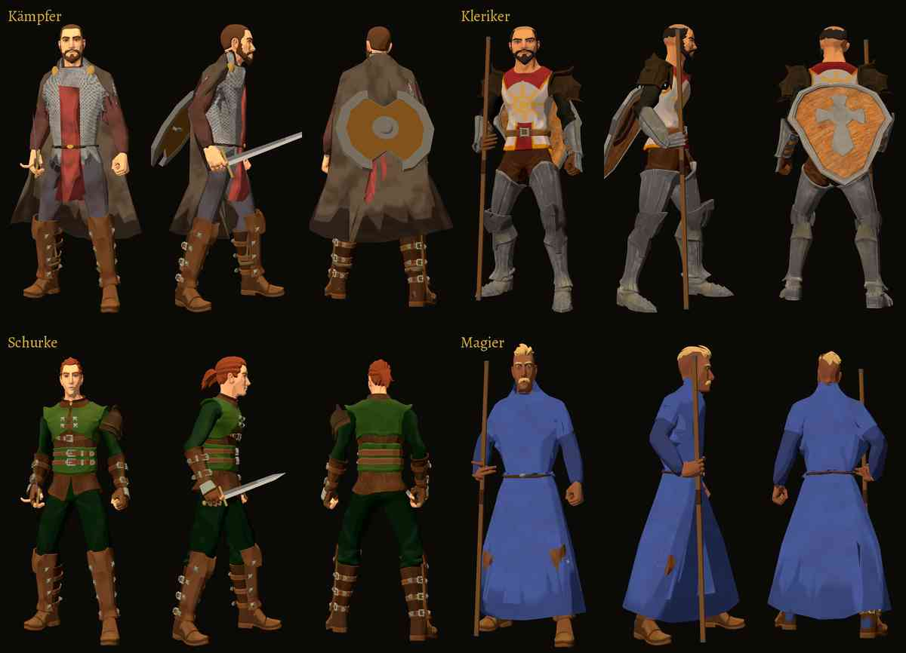

# 499 · Held im Drehteller der Erschaffung: Waffe in der Hand, Schild auf dem Rücken · Team Tom (Spike) · 03.11., 14:0x

Bild: Telegram 03.11., 14:0x

Kurz: nichts schwebt mehr; Schwert und Stab sind in der Hand, der Schild auf dem Rücken. Von vorn ist die Hand noch offen, und der Schild steht unten ab, beides wie im Dorf
Geprüft an: https://github.com/tramour-cmyk/androidapp_rpg_bornim/actions/runs/41637024666 (Lauf 2 von 2, Commit 9d8625b24)

**Zu sehen:** der Held jeder Klasse mit seiner Startausrüstung im Drehteller, wie in der Erschaffung und im Menü Held, je in drei Drehungen.

**Was falsch war:** Waffe und Schild hingen in der Erschaffung an der Figur vorbei: Der Drehteller verkleinert den Helden, die Waffe in der Hand wurde aber nicht mit verkleinert (Stab anderthalbmal zu groß, 22 cm neben der Faust). Dazu fehlten im Bau die Gehbewegungen mit Waffe, darum hingen Schwert und Schild beim Kämpfer und beim Schurken auf dem Rücken. Behoben; der Held ist jetzt so groß wie vorher ohne Ausrüstung.

**Gemessen:** Kämpfer und Schurke halten das Schwert an der Faust (0 cm), Größe wie die Figur. Kleriker und Magier halten den Stab in der Faust, sein Fuß steht am Boden wie im Dorf.

**Prüfer (03.11., 14:05):** Alle Figuren sind ganz im Bild, nichts fehlt, nichts schwebt frei. Von der Seite umfasst jede Faust die Waffe. Von vorn ist die Hand offen, die Waffe liegt nur zwischen den Fingern, bei allen vier. Der Schild von Kämpfer und Kleriker liegt oben an und steht unten etwa 20 bis 25 cm vom Rücken ab. Von hinten scheint unten an den Stiefeln Stoff durch (Kämpfer, Magier). Beim Magier scheinen auf Kniehöhe die Beine durch die Robe.

**Stärkstes Gegenargument:** Was der Prüfer findet, kommt nicht vom Drehteller. Hand, Schild und Robe sind dieselben wie im Dorf, im Drehteller sieht man sie nur von nahem. Wer sie hier behebt, ändert sie auch in der Welt; das gehört zu den offenen Punkten von 417 und 463.

**Zu sagen:** passt oder nicht. Wenn die offene Hand und der abstehende Schild jetzt behoben werden sollen, dann nach deinem Wort für Erschaffung und Welt zugleich.

Erledigt: Antwort ins Vorgangsarchiv, Datei löschen (Spike).
