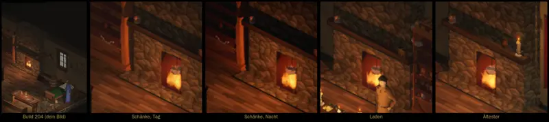

# 501 · Kaminfeuer sitzt auf dem Holz statt zu schweben · Team Tom (Spike) · 03.11., 13:22

B Innenräume
Kurz: Flamme beginnt jetzt an den Scheiten, in Schänke, Laden und beim Ältesten; links dein Bild aus Build 204
Geprüft an: https://github.com/tramour-cmyk/androidapp_rpg_bornim/actions/runs/41629412745 (Lauf 2, Commit d7d25e450)

Großbild: Telegram 03.11. 13:22

**Zu sehen:** Gemessen schwebte die Flamme 8 cm über den Holzscheiten: der Flammenpunkt lag zu hoch und die Flamme wurde noch einmal angehoben. Jetzt beginnt sie 2 cm in den Scheiten, in allen drei Kaminen; Bewegung und Ton der Flamme sind unverändert, Kerzen sitzen 5 mm tiefer. Im Tempel gibt es keinen Kamin, im Dorf kein Feuer. Ein Test misst es künftig bei jedem Bau.

**Prüfer (03.11., 13:21):** In allen vier Ausschnitten sitzt die Flamme unten bündig im Feuerloch, ohne Abstand; die Scheite sind darunter nicht zu erkennen (dunkles Holz im dunklen Loch).

**Stärkstes Gegenargument:** Die Scheite sieht man im Bild nicht; ohne Glut darunter wirkt der Fuß der Flamme hart. Eine glühende Glut auf dem Holz wäre ein eigener Schritt.

**Zu sagen:** „501 passt“, oder was anders sein soll.

Erledigt: Antwort ins Vorgangsarchiv, Datei löschen (Spike).
