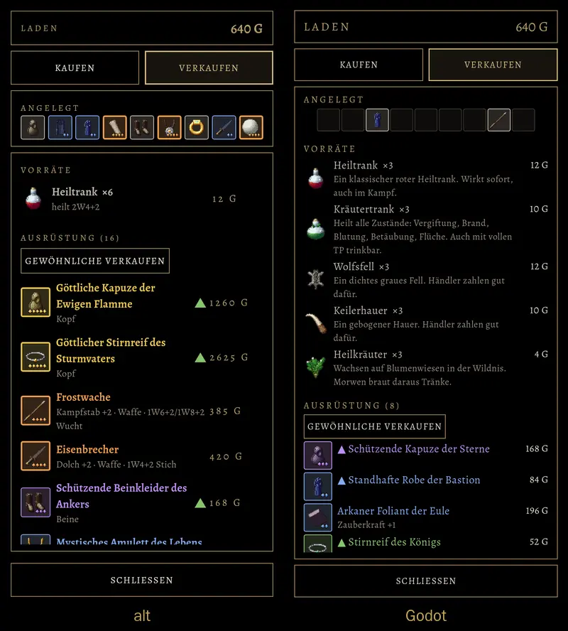
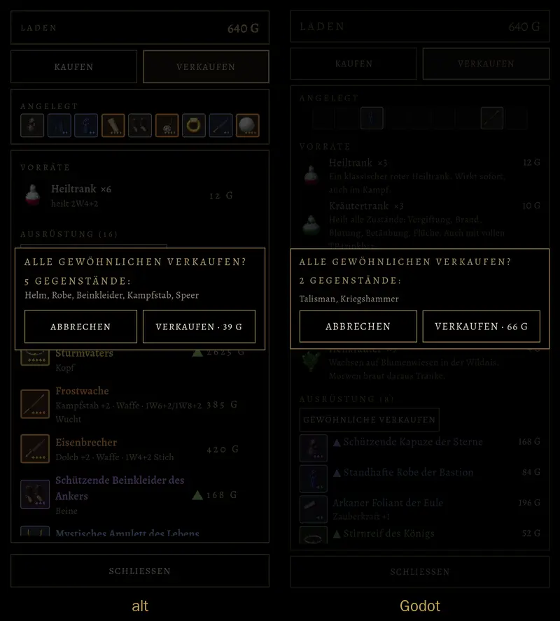

# 503 · Laden: Knopf „Gewöhnliche verkaufen“ und Rückfrage wie alt · Team Tom (Spike) · 03.11., 11:55

[Bild von 03.11., 11:55](https://github.com/tramour-cmyk/androidapp_rpg_bornim/blob/bilder/2026-11/03-1155-503-Spike.png) (Spike)

B Oberfläche
Kurz: Knopf zeigt seinen Text, Rückfrage wie im alten Spiel; Bild alt neben Godot
Geprüft an: https://github.com/tramour-cmyk/androidapp_rpg_bornim/blob/bilder/2026-11/03-1155-503-Spike.png (Bildprobe `laden_bild_503` Lauf 2, Vorschau `HAENDLER=503` alt, Test `laden_503`; Commit 67e6e2cf2, Zweig `claude/spike-503-laden`)

**Zu sehen:** Der Knopf unter „Ausrüstung“ war nur ein leerer Rahmen, weil er null breit gebaut wurde; jetzt steht „Gewöhnliche verkaufen“ darin wie alt (keine eigene Anzahl am Knopf). Die Rückfrage wie alt: Titel, „n Gegenstände:“ in Gold, darunter die Namen matt, unten „Abbrechen“ links und „Verkaufen · Preis“ rechts nebeneinander (vorher untereinander, Verkaufen oben). Die Knöpfe nebeneinander gelten für alle Rückfragen im Spiel, wie im alten Spiel ein Kasten für alle. Derselbe Fehler steckte in den Knöpfen „Gebietskarte“ und „Chronik“ auf der Karte; dort ebenso behoben (ohne Bild, getestet). Die Zahl der Gegenstände weicht nur ab, weil die Proben verschiedene Taschen haben.

**Prüfer (03.11., 11:46, vor dem Knopfumbau):** Text im Knopf beider Fassungen ganz lesbar; im Kasten nichts abgeschnitten; Unterschied nur die Knopfreihe (seitdem angeglichen).

**Stärkstes Gegenargument:** Die Knopfreihe ändert jede Rückfrage im Spiel, nicht nur diese; lange Aufschriften (etwa „Verkaufen ×5 · 2625 G“) stehen jetzt in halber Breite.

**Zu sagen:** „503 passt“, oder was anders sein soll.

Erledigt: Antwort ins Vorgangsarchiv, Datei löschen (Spike).
