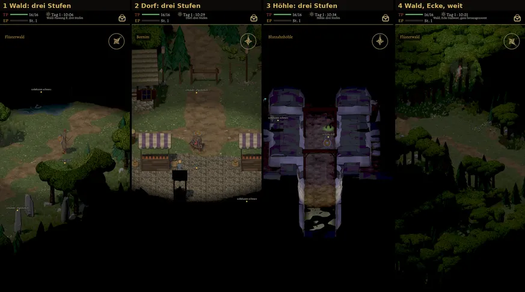
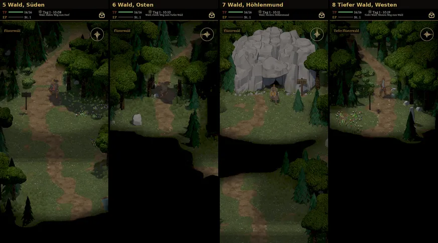
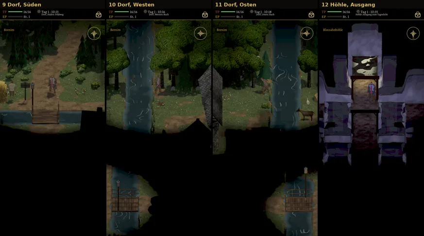
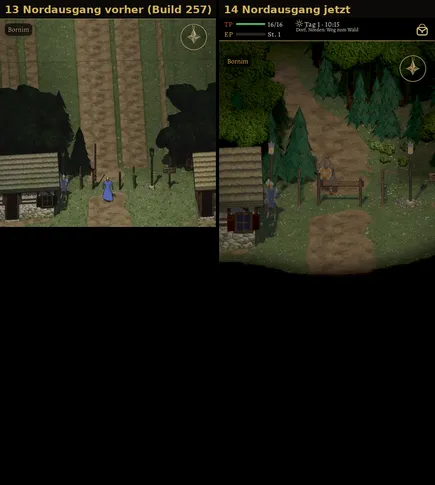

# 505 · Nebel, Randwald und Ausgänge, zweiter Durchgang · Team Tom · 04.11., 19:03

[Bild von 04.11., 19:03](https://github.com/tramour-cmyk/androidapp_rpg_bornim/blob/bilder/2026-11/04-1903-505-Tom.png) (eingetragen von meldung.sh, Tom)

A Spiel
Kurz: Umgesetzt sind dein Wort von 16:12 („Richtung gut … Licht, Schatten, Signatur“), die Prüferpunkte von 16:01 und dein Bild vom Nordausgang (17:18). Das ist der zweite und letzte Bildlauf für diese Runde. Sag „passt“ (dann geht es in den nächsten Build) oder was anders sein soll.

Was neu ist:
- „Nie gesehen“ ist jetzt schwarz (Helligkeit 0), auch Bäume, Steine, Lichter, Rauch, Glut und der Lichtstrahl in nie gesehenen Räumen.
- Der Randwald liegt im selben Nebel und läuft ohne harte Kante ins gleiche Schwarz aus.
- Höhlenmund: Fels mit Tuschelinie über dem Mund, die Höhle sitzt vorn im Boden; der Ausgang innen zeigt Tageslicht ohne Fleckmuster.
- Dorf mit Nebel; Häuser als Ganzes gesehen oder nicht.
- Nordausgang (Bild 13 und 14): neben jedem Ausgang Sträucher und junge Fichten in der Gasse, ab dem Schlagbaum enger Wald links und rechts des Wegs.

Gemessen (Helligkeit 0–255):
- Wald: nie gesehen 0; dieselbe Kachel erst in Sicht 77, dann erkundet 57 (0,74).
- Dorf: nie gesehen 0, erkundet 50 (am Rand 43), in Sicht 77.
- Höhle: nie gesehen 0 (eine Messstelle 27, sie lag am weichen Übergang), in Sicht 49; „erkundet“ lag in keinem Bild.
- Weitester Blick über den Kartenrand bei jedem Zoom und jeder Neigung: 12,8 m, genau so breit wie der Randwald.

Bekannt (vom Prüfer am Rechner um 17:21 gesehen, in diesem Lauf noch nicht behoben):
- An den Nebelkanten ein schmaler farbiger Saum. Danach behoben (`0dc692129`), fährt im nächsten Lauf mit.
- Der Randwald läuft oben im Bild nicht ganz bis Schwarz; an einer Stelle eine senkrechte Kante.
- Vor dem Höhlenmund ein schwarzer Querstreifen über dem Weg, die Laibung wirkt bläulich, der Fels ist glatt mit dünner Tusche.
- Höhle: in dunklen Flächen leichte Rot- und Blaustiche, Kante pixelig.
- Dorf: Häuser am Nebelrand waagerecht durchgeschnitten, der Brunnen als schwarze Schablone.
- Die Höhle selbst (Kristalle, Truhe, Lichtstrahl, Teich, Gitter nach dem alten Spiel) ist nach diesem Lauf gebaut und kommt mit Vorgang 492.

Befund des Prüfers (19:07, nach dem Versand; nicht behoben):
- Signatur: Licht aus einer Quelle ja in allen Bildern außer der Höhle (3, 12: Wände hell lila ohne Quelle, leichter Lilaglanz an Felskanten). Tuschelinie bei dieser Bildgröße kaum zu beurteilen, am Höhlenmund (7) fehlt sie. Nur Gold glänzt: ja, außer Höhle fraglich.
- Nebel: nie gesehen schwarz, erkundet etwa 0,6 von in Sicht. Höhle (3): an einer Messstelle ist eine Wand zu sehen, am linken Rand scheint ein türkiser Schein ins Schwarz. Bei 7, 10, 11 liegt ein schwarzes Band mit harten Kanten zwischen zwei gesehenen Flächen (Verdeckung oder Fehler, offen). Bei 6, 9, 14 und am Tiefen Wald harte Sichtgrenze ohne Übergang.
- Randwald: bei 4 und 6 eine harte senkrechte Kante ins Schwarz, bei 5 unten eine harte Kante, der Weg läuft gerade hinein.
- Höhlenmund (7): kein grüner Fleck mehr, Geröll und Gras am Fuß. Fels weiter hellgrau, heller als das Gras, ohne Umrisslinie; der Mund innen blaugrau, wirkt wie ein Vorhang. Höhlenausgang (12): weiter ein fleckiges Rechteck, kein Tageslicht.
- Ausgänge: Nordausgang (14) ohne die geraden Streifen, Weg biegt ab, Fichten beidseits, rechts vom Schlagbaum aber noch etwa 2 m freies Gras. Wald Süden (5) Weg gerade ins Schwarz; Bach im Dorf (10, 11) läuft gerade bis zum Rand.
- Weitere Fehler: Brunnen (2) und ein Haus (9), ein Dach (10) als schwarze Schablone auf sichtbarem Boden; Hauswand abgeschnitten (11); Höhle mit helleren Flecken auf den Wänden und Lilastich; bei 4 ein runder Ausschnitt um den Helden mit sichtbarer Kante.

Die Bildrate misst du im nächsten Build (Testmenü „FPS“, Wald am Kartenrand).

Geprüft an: https://github.com/tramour-cmyk/androidapp_rpg_bornim/commit/99edbd609 (Zweig `claude/tom-505-rand`, Lauf [41872344111](https://github.com/tramour-cmyk/androidapp_rpg_bornim/actions/runs/41872344111), Bildlauf 2 von 2; Tests nebel_505, rand_505, wald_490, hoehle_492, kartennebel_505 ohne Fehler).

Erledigt: Antwort ins Vorgangsarchiv, Datei löschen (Tom).
