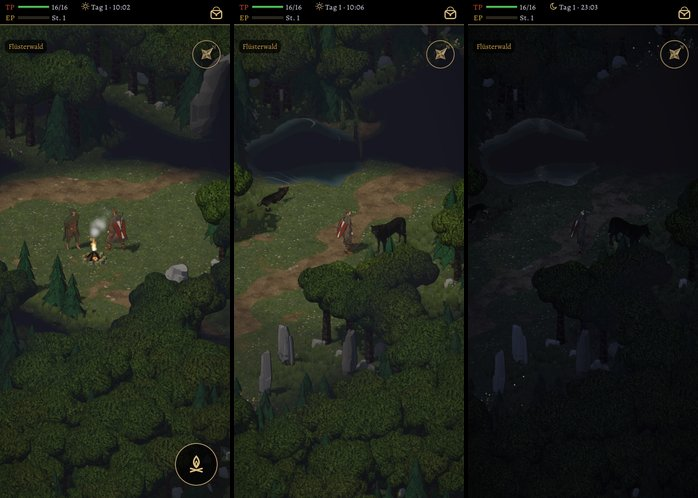

# 505 · Nebel im Wald: Sicht rundum eingebaut · Team Tom (Spike) · 03.11., 11:24

[Bild von 03.11., 11:24](https://github.com/tramour-cmyk/androidapp_rpg_bornim/blob/bilder/2026-11/03-1124-505-Spike.png) (eingetragen von meldung.sh, Spike)

W Welt
Kurz: Sicht rundum (Chef 10:08 „505 C“), Kanten weich, Lauf 1 von 2 nach dem Urteil
Geprüft an: https://github.com/tramour-cmyk/androidapp_rpg_bornim/actions/runs/41613223081 (Lauf 1, Commit 697fbe7a5)

Großbild: Telegram 03.11. 11:24

**Zu sehen:** Der Held sieht jetzt rundum gleich weit (Reichweite wie gebaut, Urteil am Gerät). Bild 1 dieselbe Stelle wie die Formen beim letzten Mal (an Garricks Feuer), frisch betreten; Bild 2 nach dem Weg nach Norden, oben links der Teich (der Weg hinter ihm bleibt gedämpft); Bild 3 nachts. Behoben aus dem letzten Befund: die Nebelkanten folgten den Feldern als Zickzack, jetzt weicher; die Umrisslinie am Teichufer lag über dem schwarzen Nebel, jetzt darunter. Neu, noch ohne Bild (getestet): die Karte im Menü zeigt im Wald nur, was der Held schon gesehen hat, der Rest bleibt leeres Pergament wie im alten Spiel. Höhle folgt mit der Blutzahnhöhle.

**Prüfer (03.11., 11:23), Fehler aus den Bildern:** Held überall ganz und klar, rundum frei; kein Zickzack mehr, die Übergänge breiter und weicher; keine Uferlinie im Nebel.
- Der Teich ist innen schwarz, sein Rand ringsum hell, auch auf der abgewandten Seite; nachts ist der Rand das Hellste im Bild.
- Nachts sind Held und Platz um ihn nur knapp heller als der Nebel; die Bäume unten fast schwarz (war vorher schon so).
- Bild 1: ein schwarzer Streifen zwischen Lichtung und sichtbarem Gras dahinter; eine Baumkrone ganz in Nebelfarbe über ihrem sichtbaren Stamm; die obere Nebelkante läuft als lange gerade Schräge.
- Bild 2: Schilfhalme ragen hell in den schwarzen Nebel.

**Stärkstes Gegenargument:** Teich und Nacht sind noch nicht sauber (oben); die nächste Runde würde zuerst das Wasser unter den Nebel bringen und die Nacht aufhellen.

**Zu sagen:** „505 passt“, oder was anders sein soll.

Erledigt: Antwort ins Vorgangsarchiv, Datei löschen (Spike).
