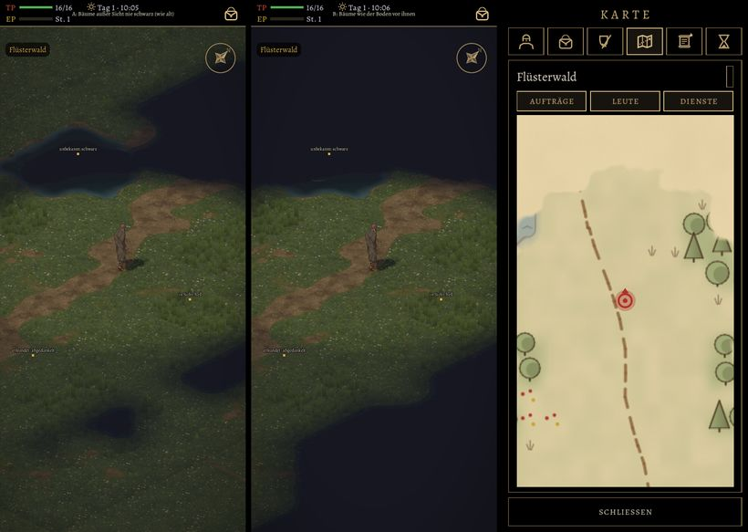

# 505 · Nebel im Wald: drei Stufen beschriftet, Bäume A oder B · Team Tom · 03.11., 22:3x

W Welt
Kurz: Lauf 2 nach deiner Freigabe (20:20), jetzt mit Bäumen (Fehler 518 behoben); Bilder: A, B, Karte im Menü. Das Bild von 21:24 ist überholt (ohne Bäume).
Geprüft an: https://github.com/tramour-cmyk/androidapp_rpg_bornim/actions/runs/41715601497 (Commit d9d8dc74d, Tests Nebel und Kartennebel ohne Fehler)

Großbild: Telegram 03.11. 22:3x

**Wo:** Der Held ist vom Dorf nach Norden in den Flüsterwald gegangen, Kachel für Kachel, und steht vor Garricks Lichtung; der Teich liegt oben links von ihm. Bild 3 zeigt dieselbe Stelle auf der Karte im Menü (gestrichelter Weg, roter Punkt = Held).

**Zu sehen:** Je Bild drei goldene Punkte mit Schrift, jeder auf einer Kachel dieser Stufe: „unbekannt: schwarz“ (nie gesehen), „erkundet: abgedunkelt“ (schon gesehen, jetzt außer Sicht), „in Sicht: hell“.
- **A, wie im alten Spiel:** Bäume außer Sicht werden nie schwarz, nur gedämpft (alte Regel). Darum stehen auch hinter dem nie gesehenen Teich Bäume im Nebel; das war dein Eindruck um 16:13.
- **B:** Bäume übernehmen die Stufe des Bodens vor ihnen; der Wald um den nie gesehenen Teich ist dann schwarz.
- **Teich:** Der Teich war auf dem Weg nie in Sicht, darum ist er schwarz. Das ist kein Zeichenfehler; der halbe Teich vom letzten Mal war der Rand der Sicht.

**Prüfer (03.11., 22:37, gemessen):** Bäume wieder da; A etwa 15 Kronen, außer Sicht gedämpft, nicht schwarz; B außer Sicht schwarz, nur hell und schwarz, keine abgedunkelte Stufe erkennbar. Held ganz, mit Haar, Schild auf dem Rücken, Waffe in der Hand.
- Der Punkt „erkundet: abgedunkelt“ liegt auf Gras, fast so hell wie beim Helden (57 gegen 65); „in Sicht: hell“ liegt auf einer dunkleren Baumkrone.
- Die Überschrift ist klein und steht unter der oberen Leiste.
- B: ein einzelner senkrechter dunkler Strich ragt aus dem Schwarz.

**Stärkstes Gegenargument:** B ist ehrlicher („wenn ich es nicht sehe, dunkel“), aber der Wald zerfällt in schwarze Löcher, und man erkennt seine Form nicht mehr; A behält die Form, verrät aber Bäume, die der Held nie gesehen hat.

**Zu sagen:** „505 A“ oder „505 B“, oder was anders sein soll.

Erledigt: Antwort ins Vorgangsarchiv, Datei löschen (Tom).
