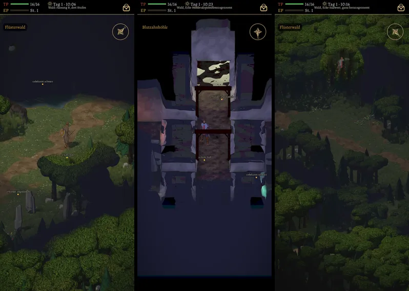
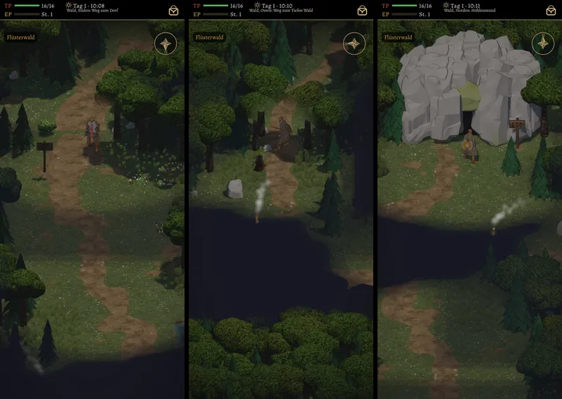
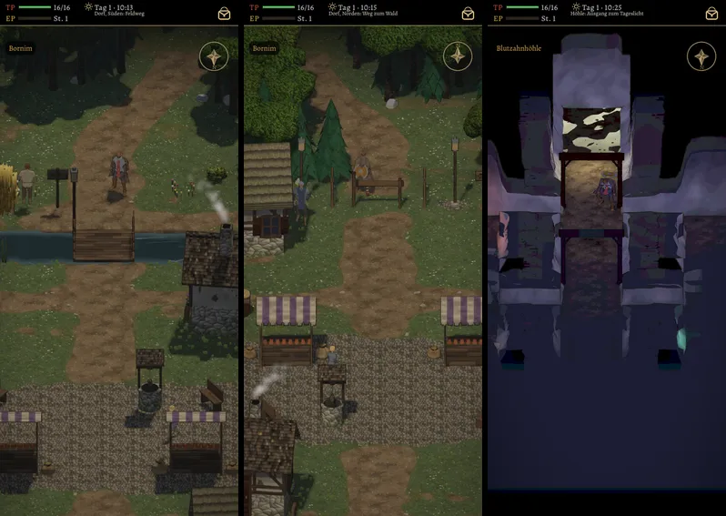

# 505 · Nebel, Randwald, Kamera und Ausgänge in Wald, Dorf und Höhle · Team Tom · 04.11., 15:59

[Bild von 04.11., 15:59](https://github.com/tramour-cmyk/androidapp_rpg_bornim/blob/bilder/2026-11/04-1559-505-Tom.png) (eingetragen von meldung.sh, Tom)

A Spiel
Kurz: Dein Urteil von 14:06 („505c“) umgesetzt, erster von zwei Durchgängen. Nebel nach B, dahinter ein Randwald ohne Nebel, der ins Dunkel ausläuft, die Kamera bleibt über der Karte, die Wege laufen über den Rand hinaus weiter. Sag „passt“ (dann kommt es nach dem zweiten Durchgang, der die Punkte unter „Bekannt“ behebt, in den nächsten Build) oder was anders sein soll.

Was neu ist:
- Nebel B in Wald, Dorf und Höhle: nie gesehen fast schwarz (siehe „Bekannt“), auch die Bäume; erkundet dunkler als in Sicht, aber erkennbar. In der Höhle endet die Sicht am ersten Fels (wie alt).
- Randwald: 11 Kacheln breit um jede Karte (innen der Waldring bis Kachel 6, außen einfache Bäume ohne Wind bis 11), ohne Nebel, nach außen dunkler bis schwarz.
- Kamera: zeigt nie mehr als Karte und Randwald. In der Ecke wird der Ausschnitt dafür kleiner (Bild 3: 12,9 statt 14,4 m), an den Rändern bleibt er.
- Ausgänge: Wege biegen hinter dem Rand zur Seite und verlieren sich unter Kronen, Bäche laufen gerade ins Dunkel, der Gang aus der Höhle bleibt hell nach außen; über dem Höhlenmund liegt Fels. Die Liste aller Ausgänge gegen alt steht im Vorrat von Team Tom („Zu 505 (Ausgänge)“).

Gemessen (Helligkeit 0–255, Mitte der beschrifteten Kachel):
- Wald: nie gesehen 24, erkundet 46, in Sicht 60. Das sind zwei verschiedene Kacheln, darum nur ungefähr: erkundet ist 0,77 von „in Sicht“ (heute früh 57 gegen 65, also 0,88).
- Höhle: nie gesehen 31, in Sicht 46.
- Weitester Blick über den Kartenrand bei jedem Zoom und jeder Neigung: 12,8 m, genau so breit wie der Randwald (864 Kamerastellungen).
- Rechenlast des Randwalds: plus 4 %.

Bekannt, kommt mit dem zweiten Durchgang:
- „Nie gesehen“ misst 24 und 31 statt 0. Die Ursache ist noch offen.
- Höhle: der Wert für „erkundet“ fehlt noch; die Messstelle lag im hellen Gang zum Ausgang (64, gilt nicht).
- Noch nicht gemessen: dieselbe Kachel erst in Sicht und dann erkundet; sie lag außerhalb des Bilds.
- Nicht im Bild: Dorf West und Ost (Bach), Tiefer Wald West.
- Die Bildrate am Gerät fehlt, entgegen deinem Auftrag vor der Vorlage; messen kannst nur du, mit dem Testmenü „FPS“ im nächsten Build.

Geprüft an: https://github.com/tramour-cmyk/androidapp_rpg_bornim/actions/runs/41844009083 (Commit 92b43b3ae auf `claude/tom-505-rand`); Tests `nebel_505`, `rand_505`, `kartennebel_505`, `wald_490`, Skripte ohne Fehler.

Antwort:
