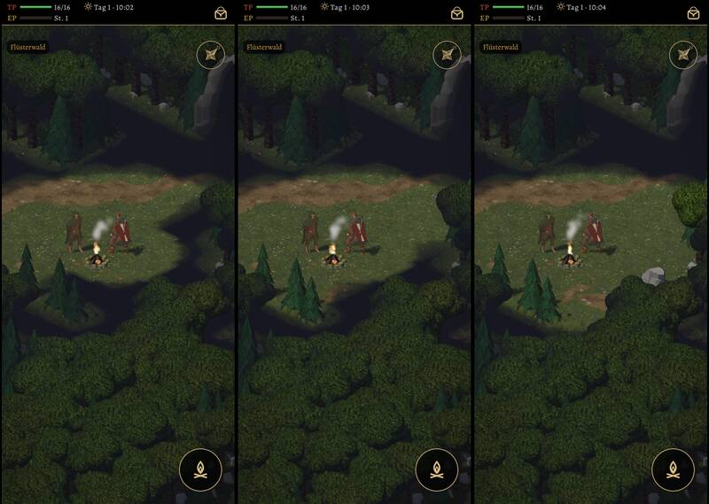
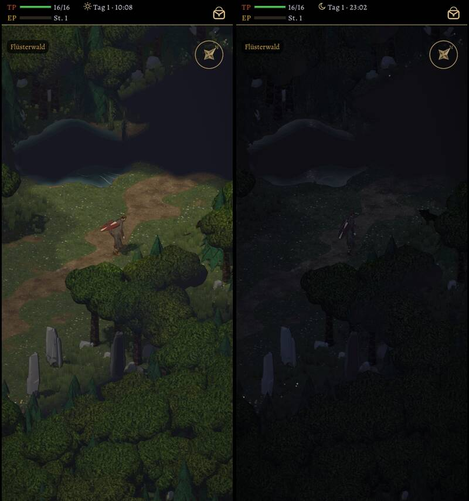

# 505 · Nebel im Wald: welche Form hat das Sichtfeld des Helden? · Team Tom (Spike) · 03.11., 09:41

[Bild von 03.11., 09:41](https://github.com/tramour-cmyk/androidapp_rpg_bornim/blob/bilder/2026-11/03-0941-505-Spike.png) (eingetragen von meldung.sh, Spike)

W Welt
Kurz: Nebel wie alt gebaut, Form des Sichtfelds zur Wahl, Lauf 2 von 2
Geprüft an: https://github.com/tramour-cmyk/androidapp_rpg_bornim/actions/runs/41601615757 (Lauf 2, Commit d8bb53ffb)

Großbild: Telegram 03.11. 09:41

**Zu sehen:** Der Nebel wie in der alten Fassung (Chef 07:30: „den Nebel brauchen wir auf jeden Fall“): fast schwarz, was der Held nie gesehen hat; halb dunkel, was er gesehen hat, aber gerade nicht sieht; klar, was er sieht. Bäume und Felsen sperren die Sicht; Bäume sind nie schwarz, nur gedämpft (wie alt). Was er gesehen hat, bleibt im Spielstand. Monster und Leute außer Sicht sind nicht zu sehen. Bild 1: dieselbe Stelle frisch betreten, Blick nach Westen, drei Formen; die Formen unterscheiden sich seitlich und hinter dem Helden (C sieht auch nach hinten). Bild 2: Form A nach dem Weg herauf (der Weg hinter ihm bleibt gedämpft), dann nachts (kürzere Sicht).

**Formen:**
- **A** wie alt: Kegel 160° in Gehrichtung, dazu ringsum 2 Felder; Sicht 5,2 Felder am Tag, nachts 4,2, mit Fackel 6,5.
- **B** breiter: Kegel 240°, sonst wie A.
- **C** rundum gleich weit.

**Prüfer (03.11., 09:41):** Die Nebelkanten sind weich, folgen aber den Feldern als Zickzack. Das Wasser des Teichs liegt über dem Nebel (Uferlinie im Schwarz zu sehen). Nachts sind Held und klarer Bereich kaum zu erkennen. Nach vorn reicht die Sicht etwa fünf Felder, danach schwarz; der Prüfer hielt das für zu kurz.

**Stärkstes Gegenargument gegen A:** Nach vorn sieht der Held nur gut fünf Felder, auf dem Handy ist das ein Viertel des Bildes; C ist am einfachsten zu verstehen, nimmt aber den Überfall von hinten aus dem Blick.

**Zu sagen:** „505 A“, „B“ oder „C“, gern mit weiterer oder kürzerer Sicht; dann baue ich die Form fest ein und behebe die Befunde oben.

Erledigt: Antwort ins Vorgangsarchiv, Datei löschen (Spike).
