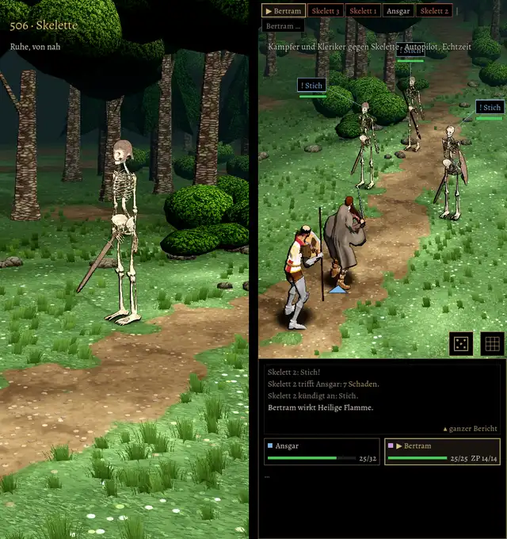

# 506 · Skelette im Kampf (gekauftes Modell) · Tom · 09.11., 21:56

Die Skelette bauen auf dem gekauften Skelettritter auf. Es gibt drei Ausstattungen: Kurzschwert mit Helm, Kurzschwert mit Schild, Speer mit Helm. Links steht ein Skelett von nah, rechts kämpfen Kämpfer und Kleriker gegen drei Skelette im Wald.

Seit dem Probebild vom 08.11. geändert:
- Im Stehen und Gehen halten sie die Waffe nicht mehr waagerecht zur Seite. Das Schwert hängt schräg vor dem Bein, der Speer steht aufrecht.
- Der Speer ist dicker und hat eine sichtbare Spitze, der Schild ist größer. So erkennt man die drei Ausstattungen besser.
- Die Augenhöhlen sind dunkel, in jeder glimmt ein schwacher Glutpunkt.
- Der Schatten am Boden ist schmaler und heller, damit unter den dünnen Knochen keine dunkle Scheibe mehr liegt.
- Im Nahbild ist nur ein Skelett zu sehen. Im Kampf stehen die Lebensbalken über den Köpfen.

**Offen:**
- Der Helm hat einen Sehschlitz vor den Augen. Die Kante darüber verdeckt die Augen, wenn man von oben schaut. Den Helm habe ich unverändert gelassen.
- Zahnreihen sind von nah kaum zu sehen.
- Das Kurzschwert ist vorn rund, so kommt es im gekauften Modell.
- Die Knochen wirken im Licht des Waldes eher weiß als vergilbt.

Geprüft an: [85b1ec962](https://github.com/tramour-cmyk/androidapp_rpg_bornim/commit/85b1ec962) (Test skelett_506 ohne Fehler: drei Ausstattungen, Kämpfer gewinnt gegen drei Skelette), Zweig `claude/tom-506-skelett`. Zombie und Ghul kommen danach.

Sag „passt“ oder was anders sein soll.
