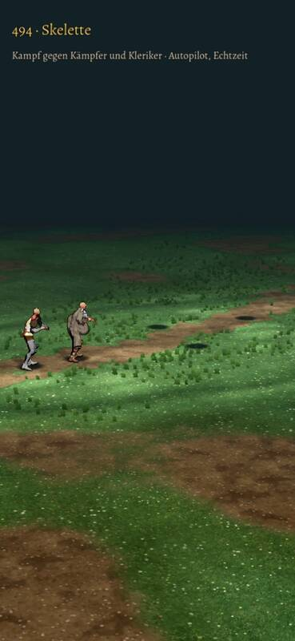

# 506 · Skelette im Kampf: Film, Skelette fehlen im Bild · Team Tom (Spike) · 03.11., 12:45

E Kampf
Kurz: zweiter Lauf, Film geht nach der Regel an dich; die Skelette sind nicht zu sehen, Ursache suche ich ohne neuen Lauf
Geprüft an: https://github.com/tramour-cmyk/androidapp_rpg_bornim/actions/runs/41620499067 (Lauf 2, Commit c3888eba5)

Film: Telegram 03.11. 12:45

**Zu sehen:** Kampfort Wald, drei Skelette gegen Held und Kleriker, 24 s. Der erste Lauf brach ab, bevor ein Film entstand (der Bau eines anderen Gegners scheiterte); das ist der zweite und letzte.

**Prüfer (03.11., 12:44):** Die drei Skelette sind in keinem Bild zu sehen; wo sie stehen, liegen nur ihre Schatten auf dem Boden. Held und Kleriker haben keine Waffe in der Hand und keinen Schild. Bei 4,75 bis 5,5 s sind Held und Kleriker am linken Rand angeschnitten. Treffer und Tod kommen im Film nicht vor (der Kampf läuft nach 18 s noch).

**Stärkstes Gegenargument:** Der Film zeigt vom Skelett nichts; zu urteilen gibt es erst nach dem Beheben.

**Zu sagen:** Nichts nötig; zwei neue Läufe gibt dein Urteil oder Sokrates frei. Ich stelle die Ursache am Rechner nach (ohne Lauf).

Erledigt: Antwort ins Vorgangsarchiv, Datei löschen (Spike).
